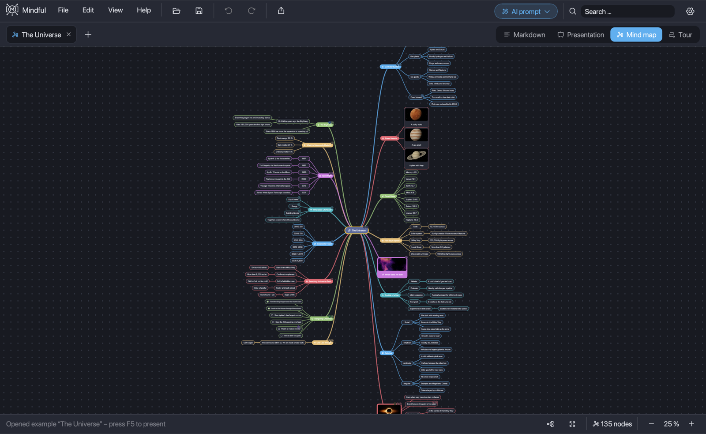
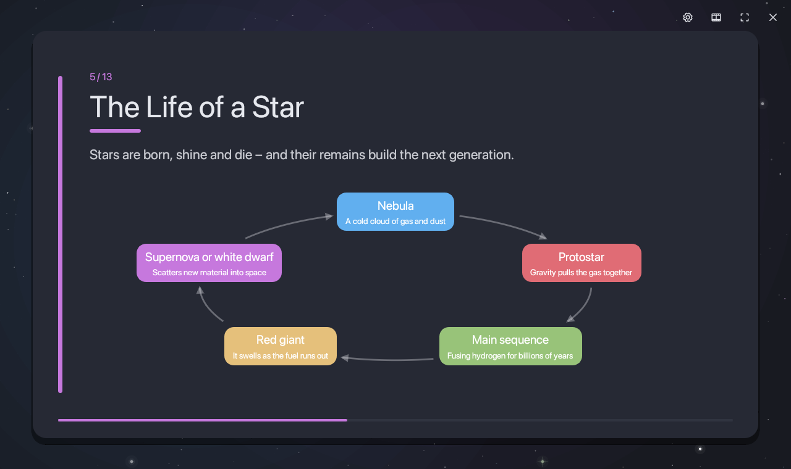
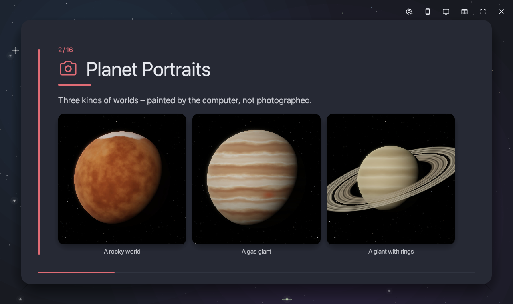
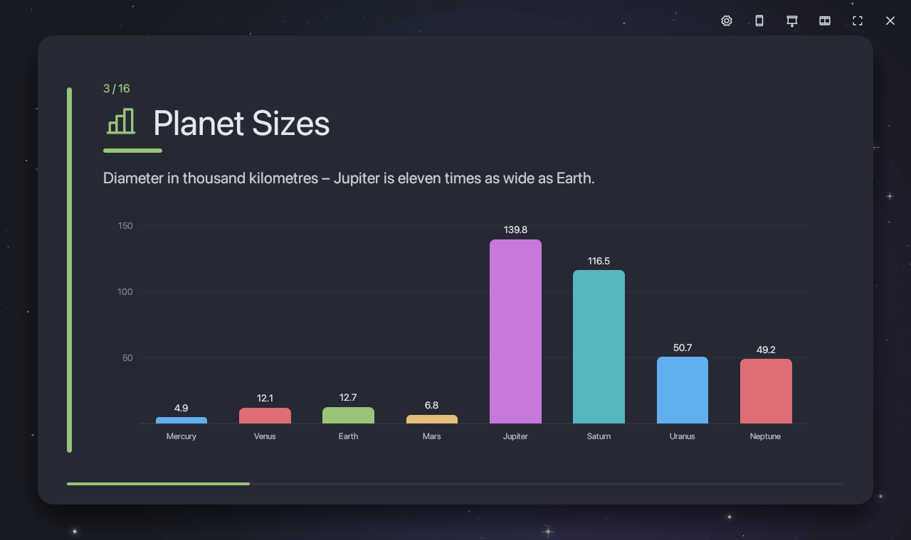
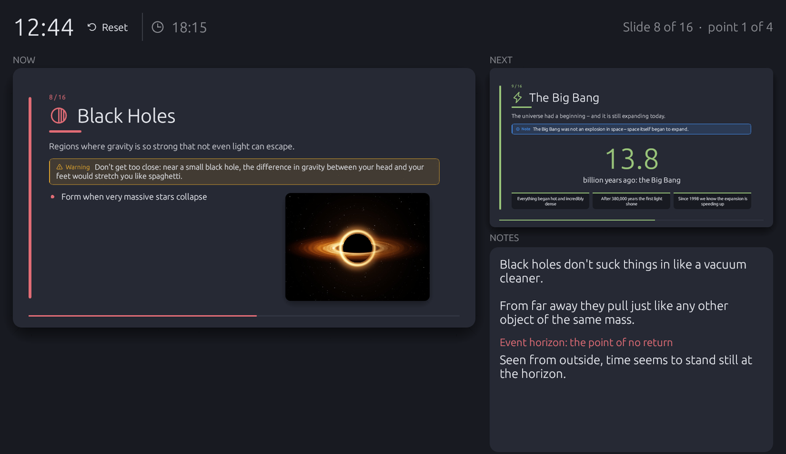

# Mindful

**Mind maps, Markdown and presentations in one small desktop app.**
Write an outline, see it as a mind map, and present it as slides or as a camera flight through the map, all from the same data. Mindful is written in Rust with [egui](https://github.com/emilk/egui). It starts instantly and keeps your mind map in a single file.

<p align="center">
  <a href="https://github.com/tj537/mindful/releases/latest/download/Mindful-macos-arm64.zip"></a>
  &nbsp;
  <a href="https://github.com/tj537/mindful/releases/latest/download/Mindful-windows-x64.zip"></a>
</p>
<p align="center"><sub><a href="#download">install notes</a> · <a href="https://github.com/tj537/mindful/releases">all releases</a> · <a href="https://github.com/tj537/mindful/actions/workflows/ci.yml"></a></sub></p>



| Diagram layouts | Pictures on slides |
|---|---|
|  |  |
| **Charts from bullet points** | **Presenter view** |
|  |  |

## Why Mindful?

Most talks, lectures and project kick-offs start the same way: a messy list of thoughts. You sort them in a mind map tool, then rebuild everything slide by slide in PowerPoint or Keynote – and from then on every change has to be made twice, in two programs that don't know about each other.

Mindful keeps **one source**: an outline that you can write as plain Markdown. The mind map, the slides and the camera tour are simply different views of it. Rename a branch in the mind map and the slide title changes. Add a bullet in the editor and it appears on the slide. Your structure stays the single source of truth from the first idea to the last slide.

### What makes it different

- **One source, four views.** Write, structure and present the same content without copying anything between apps.
- **Slides that design themselves.** Twelve layouts – timelines, cycles, pyramids, comparisons, Venn diagrams, bar, pie and line charts – are built from ordinary bullet points. Choose a layout with a right-click; no dragging boxes or fiddling with chart editors.
- **Plain text you own.** Markdown in, Markdown out. It works with Git, with any text editor and with AI assistants. A `.mindmap` file is a single file, pictures included.
- **Made for AI.** The built-in prompt teaches ChatGPT, Claude & co. Mindful's format, including which slide layout fits which content. Paste the answer and you have a structured talk with diagrams in a minute.
- **Presenting built in.** Presenter view with notes and timer, PDF export, checkboxes you tick off live, keyboard-only navigation and a camera flight through the mind map as an alternative to slides.
- **Small and fast.** A native app written in Rust: about 11 MB on disk, a 5 MB download, starts instantly and runs offline. No account, no cloud, no tracking, no subscription.
- **Open source.** MIT licensed – use it, change it, build on it.

### How it compares

| | Mind map apps | Markdown slide tools | PowerPoint / Keynote | **Mindful** |
|---|:---:|:---:|:---:|:---:|
| Visual mind map | ✓ | – | – | ✓ |
| Write the content as plain text | partly | ✓ | – | ✓ |
| Slides from the same content | partly | ✓ | – | ✓ |
| Diagrams and charts from bullet points | – | – | by hand | ✓ |
| Fly through the mind map as a talk | rarely | – | – | ✓ |
| Free and open source | rarely | often | – | ✓ |

Mindful doesn't try to replace PowerPoint for pixel-perfect corporate decks. It is for everyone who thinks in structures – students, teachers, speakers, project leads – and wants to get from an idea to a presentation without doing the work twice.

## Features

**One mind map, four views.** A change in one view shows up in the others right away.

| View | What it's for |
|---|---|
| **Markdown** | Write fast: `#` central topic, `##` main branches, `-` points, plain lines as notes, with a live preview |
| **Presentation** | A title slide plus one slide per main branch; bullet points appear one by one |
| **Mind map** | Collect and arrange ideas: drag, color, collapse, auto layout |
| **Tour** | Present on the mind map itself: the camera flies from branch to branch and reveals what's below |

**Slides that look like slides**
- Twelve slide layouts built from your bullet points: timeline, cycle, pyramid, funnel, comparison, 2×2 matrix, Venn diagram, big number (it counts up), quote – and **bar, pie and line charts** from points like `Solar: 42 %`, animated as they build up. Pick one with a right-click on the slide.
- **Presenter view** (P): a second window with the current and next slide, your notes, a timer and the clock, while the audience sees only the slides.
- **Your phone as a remote** (R): scan a QR code and your phone shows big Next/Back buttons, the slide title, your notes and the timer. It works in your own Wi-Fi with no app and no cloud.
- **Export the slides as PDF** to send or print them.
- Pictures from your computer: drag them onto a node or a slide, or paste a screenshot. One picture sits beside the text, a single picture fills the slide, several become a gallery.
- Checkboxes you can tick off during the talk, with confetti if you like.
- Transitions, bullet effects, animated backgrounds (a starfield by default), a laser pointer and a quick-jump strip. Everything is optional under ⚙︎.

**Writing and organizing**
- **Icons on nodes:** 64 icons from the right-click menu, written as `:rocket:` in Markdown and shown in the branch colour on the mind map and the slides. Typed emojis work too.
- Tabs, undo/redo, search, copy & paste, notes on every node, 8 color themes.
- Mindful tells you when a new version is out (one request to GitHub per start; can be switched off under *Help*).
- Templates (brainstorming, project plan, SWOT, weekly plan, meeting notes, book summary) and a complete example to explore: **File → Open example → The Universe** (also in German).
- **AI prompt:** describe a topic, copy the generated prompt into ChatGPT, Claude or any other assistant and paste the answer into a new tab. The prompt teaches the AI Mindful's format, including when to use which slide layout.
- Save as `.mindmap` (one file, pictures included), import Markdown and plain-text outlines, export the mind map as PNG, SVG or Markdown and the slides as PDF.
- Your open tabs, including unsaved changes, are restored on the next start.

## Download

| System | Download |
|---|---|
| macOS 11+ on Apple silicon (M1 and newer) | **[⬇ Mindful for macOS](https://github.com/tj537/mindful/releases/latest/download/Mindful-macos-arm64.zip)** |
| Windows 10 and 11 (64-bit) | **[⬇ Mindful for Windows](https://github.com/tj537/mindful/releases/latest/download/Mindful-windows-x64.zip)** |
| macOS on Intel, Linux | build from source (see below) |

Older versions are on the [Releases page](https://github.com/tj537/mindful/releases). Every release is built automatically by GitHub from the published source code; `SHA256SUMS.txt` next to the downloads lets you check them.

**Installing on macOS:** unzip, then drag `Mindful.app` into *Applications*.
Mindful isn't notarized by Apple yet, so macOS blocks the first launch. Open it anyway like this:

1. Double-click Mindful and close the warning.
2. Open **System Settings → Privacy & Security**, scroll down and click **Open Anyway**.

After that it opens normally. If you prefer the terminal, you can remove the download flag instead:

```bash
xattr -dr com.apple.quarantine /Applications/Mindful.app
```

**Installing on Windows:** unzip and start `Mindful.exe` – it is a single file, no installer and no admin rights needed. Move it wherever you like, e.g. into *Documents*, and right-click it → *Pin to taskbar*.
Windows SmartScreen warns about unsigned apps on the first start: click **More info → Run anyway**. When you first use the phone remote, allow Mindful on private networks.

Mindful keeps open tabs and settings in `~/Library/Application Support/Mindful/` (macOS) or `%APPDATA%\Mindful\` (Windows). Your mind maps are wherever you save them.

## Getting started

1. Open the example (**File → Open example → The Universe**) and press **F5** to present it.
2. Press **Esc** to come back, then **⌘E** to see the same content as Markdown.
3. Start your own: **⌘T** opens a new tab. **Tab** adds a child, **Enter** a sibling, right-click opens the menu.

**F1** shows all keyboard shortcuts inside the app.

### Keyboard shortcuts

On the Mac use ⌘, on Windows and Linux use Ctrl.

| Key | Action |
|---|---|
| **Mind map** | |
| Tab · Enter | Add child · add sibling |
| F2 · double-click | Rename |
| Del | Delete node and its children |
| Space | Collapse / expand |
| ⌘Enter | Add checkbox / tick it off |
| Arrow keys | Move selection |
| ⌘C · ⌘X · ⌘V · ⌘D | Copy · cut · paste · duplicate (⌘V also pastes images) |
| ⌘L | Auto layout |
| ⌘F | Find (Enter: next match) |
| ⌘0 · ⌘+ · ⌘− | Fit to window · zoom |
| **General** | |
| ⌘E | Switch between Markdown and mind map |
| F5 · F6 | Start presentation · start tour |
| ⌘Z · ⇧⌘Z | Undo · redo |
| ⌘T · ⌘W | New tab · close tab |
| Ctrl+Tab · ⌘1…9 | Switch tab |
| ⌘S · ⇧⌘S · ⌘O | Save · save as · open |
| **Presenting** | |
| Space · → · ← | Next · back |
| G | Quick jump to any slide |
| L | Laser pointer |
| P | Presenter view (notes, next slide, timer) |
| R | Phone as a remote control |
| F · Esc | Full screen · end |

Navigation while presenting is keyboard-only, so clicking a checkbox never skips a slide.

## The Markdown format

```markdown
# Title of the mind map

Introduction (becomes the subtitle of the title slide).

## A main branch <!-- timeline -->

A note on the branch, shown below the slide title.
The comment after the heading picks a slide layout (optional).

- A point
  A note on the point
  - A sub-point
- [ ] An open task
- [x] A done task
- A point with a picture
  
- :bulb: A point with an icon
```

A picture belongs to the line directly above it. Mindful stores the picture data inside the mind map. Exported Markdown carries it in a comment block at the end, so the file stays complete. When you import Markdown, picture paths next to the file are read in automatically.

### Slide layouts

| Layout | Good for | Bullet points |
|---|---|---|
| `timeline` | events in order | 3–6 points, each a date or phase with one sub-point |
| `cycle` | a process that repeats | 3–6 stages, each with one short sub-point |
| `pyramid` | levels or a hierarchy | 3–5 points from the narrow top to the broad base |
| `funnel` | narrowing down | 3–5 points from broadest to most selective |
| `compare` | 2–4 options side by side | option names with 2–4 sub-points each |
| `matrix` | a 2×2 grid such as SWOT | exactly 4 points with 1–3 sub-points |
| `venn` | overlapping ideas | 2–3 short labels plus one point saying what they share |
| `number` | one striking figure | first point starts with the number; up to 3 more facts |
| `quote` | a quotation | one point with the quote, one sub-point with the author |
| `bars` | comparing amounts | 3–8 points like `Solar: 42 %` or `Germany: 83 million` |
| `pie` | parts of a whole | 2–6 points like `Dark energy: 68 %` |
| `line` | a trend over time | 3–8 points like `2015: 1,950`, in order |

Notes on a node (right-click → *Note …*) appear in the presenter view.

## Building from source

Install Rust with [rustup](https://rustup.rs), then:

```bash
git clone https://github.com/tj537/mindful.git
```
```bash
cd mindful
```
```bash
cargo run --release
```

The first build takes a few minutes. Platform prerequisites:

- **macOS:** the Xcode command line tools (`xcode-select --install`).
- **Windows:** the [Visual Studio Build Tools](https://visualstudio.microsoft.com/visual-cpp-build-tools/) with the *Desktop development with C++* workload.
- **Linux (Debian/Ubuntu):** `sudo apt install build-essential libxcb-render0-dev libxcb-shape0-dev libxcb-xfixes0-dev libxkbcommon-dev zenity`

**Mac app bundle:** `./scripts/build-mac.sh` builds `dist/Mindful.app`. With `--install` it also copies the app into `/Applications`, with `--zip` it packs the release download. The bundle runs on Macs with the same processor type as the build machine.

**Windows:** `cargo build --release` gives `target\release\mindful.exe` with the app icon embedded (`build.rs`).

### Automatic builds and releases

GitHub Actions does the routine work:

- **On every push and pull request** ([`ci.yml`](.github/workflows/ci.yml)): formatting check, clippy and all tests on macOS, Windows and Linux.
- **On every version tag** ([`release.yml`](.github/workflows/release.yml)): builds `Mindful-macos-arm64.zip` and `Mindful-windows-x64.zip`, adds `SHA256SUMS.txt` and publishes the GitHub release.

Releasing a new version:

1. Raise `version` in `Cargo.toml` and commit.
2. Write the release notes into `.github/release-notes/v0.4.0.md` (optional – without it GitHub lists the commits).
3. Tag and push:
   ```bash
   git tag -a v0.4.0 -m "Mindful 0.4.0" && git push origin v0.4.0
   ```

A few minutes later both downloads are on the release page, and running copies of Mindful offer the update.

### Development

| Command | What it does |
|---|---|
| `cargo test` | run the tests |
| `cargo clippy --all-targets` | lint |
| `cargo fmt` | format |
| `cargo test --release render_ -- --ignored` | render every slide and the app window to `target/snapshots/` without opening a window, handy for checking visual changes |

How the code fits together (data model, the flow of a frame, Markdown sync, file format, how to add features) is described in **[docs/ARCHITECTURE.md](docs/ARCHITECTURE.md)**.

```
src/
├── main.rs            startup and window
├── app.rs             main window: menus, tabs, mind map canvas, keyboard
├── document.rs        one tab: file, view, undo/redo
├── model.rs           mind map data, auto layout, Markdown
├── markdown_view.rs   Markdown editor and preview
├── present.rs         presentation mode
├── diagrams.rs        slide layouts
├── tour.rs            camera tour
├── images.rs          inserting, scaling and drawing pictures
├── icons.rs           icons on nodes
├── remote.rs          phone remote (small web server)
├── update.rs          update check
build.rs               embeds the icon into the Windows .exe
.github/workflows/     tests on every push, builds on every release
├── nodes.rs           how nodes are drawn
├── ai_prompt.rs       the AI prompt form
├── export.rs          SVG and PNG export
├── pdf.rs             slides as PDF
├── offscreen.rs       renders egui without a window (PDF, tests)
├── theme.rs           color themes and fonts
└── snapshot.rs        offscreen rendering for tests
```

## Contributing

Bug reports and ideas are welcome in the [issues](https://github.com/tj537/mindful/issues). For code changes, please open a pull request and run `cargo fmt`, `cargo clippy --all-targets` and `cargo test` first. Most code comments are still in German; English ones are welcome.

### Known limitations

- The menu lives inside the window rather than in the macOS menu bar.
- Double-clicking a `.mindmap` file in the Finder doesn't open Mindful yet.
- Slides with a diagram layout don't show pictures. Animated GIFs show their first frame. Pictures are left out of the PNG/SVG export.
- Windows and Linux use egui's built-in font; the Mac uses the system font.
- The phone remote needs your phone in the same network. If the macOS firewall is on, allow Mindful to accept incoming connections when asked.

## License

[MIT](LICENSE)

The example pictures are generated by `examples/make_space_images.rs` and are covered by the same license. Icons by [Phosphor](https://phosphoricons.com) (MIT).
