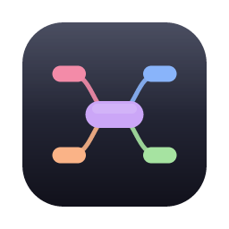
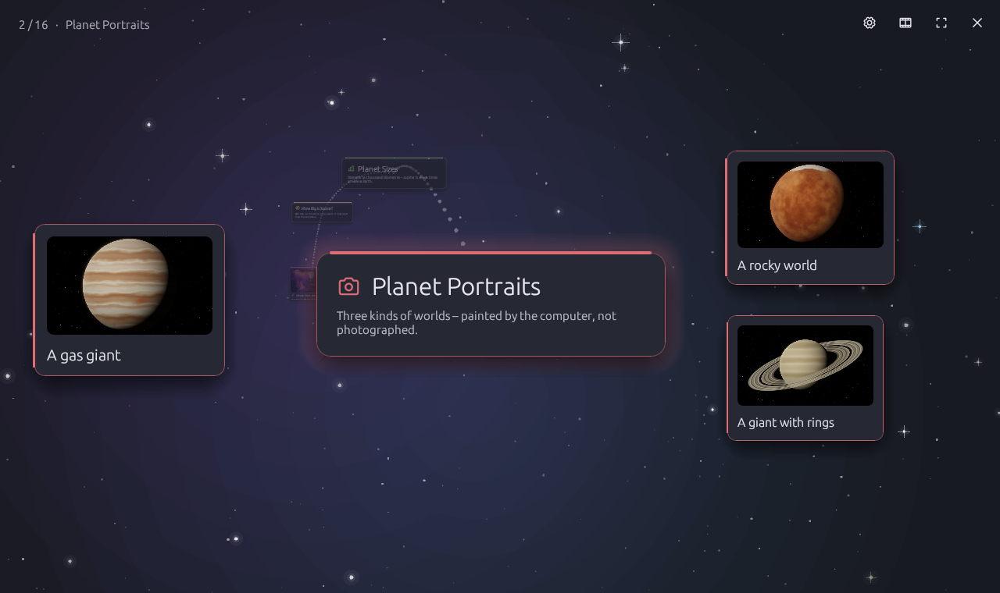
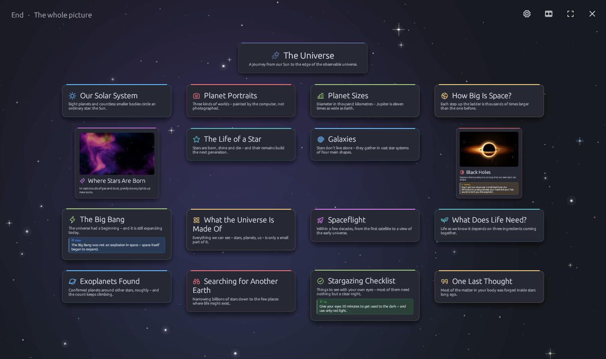
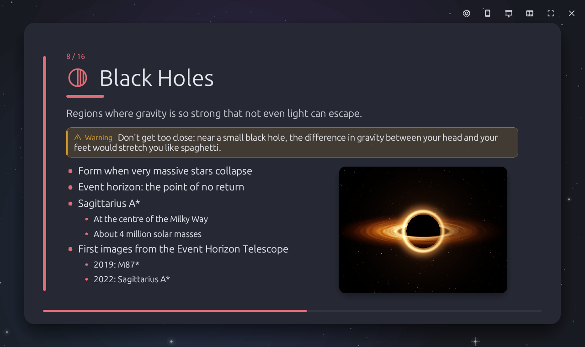

<p align="center">
  
</p>

<h1 align="center">Mindful</h1>

<p align="center">
  <b>Think it as a mind map. Write it as Markdown. Present it as slides – or fly through it.</b><br>
  One small, fast desktop app for the whole way from the first idea to the last slide.
</p>

<p align="center">
  <a href="https://github.com/tj537/mindful/releases/latest/download/Mindful-macos-arm64.zip"></a>
  &nbsp;
  <a href="https://github.com/tj537/mindful/releases/latest/download/Mindful-windows-x64.zip"></a>
</p>

<p align="center">
  <a href="https://github.com/tj537/mindful/releases/latest"></a>
  <a href="https://github.com/tj537/mindful/actions/workflows/ci.yml"></a>
  <a href="LICENSE"></a>
  
  
</p>

<p align="center"><sub><a href="#download">install notes</a> · <a href="https://github.com/tj537/mindful/releases">all releases</a> · <a href="docs/ARCHITECTURE.md">how it works inside</a></sub></p>


## 💡 Why Mindful?

Most talks, lectures and project kick-offs start the same way: a messy list of thoughts. You sort them in a mind map tool, then rebuild everything slide by slide in PowerPoint or Keynote – and from then on every change has to be made twice, in two programs that don't know about each other.

**Mindful keeps one source.** An outline you can write as plain Markdown – and the mind map, the slides and the camera tour are simply different views of it. Rename a branch in the mind map and the slide title changes. Add a bullet in the editor and it appears on the slide.

|   |   |
|---|---|
| 🧠 **One source, four views** | Markdown, mind map, slides and tour show the same content – nothing is copied between apps. |
| 🎨 **Slides that design themselves** | Twelve layouts – timelines, cycles, pyramids, Venn diagrams, bar, pie and line charts – built from ordinary bullet points. Pick one with a right-click. |
| 🚀 **Present like nobody else** | Presenter view with speaker notes, your phone as a remote, a camera flight through the mind map – or through space. |
| 📝 **Plain text you own** | Markdown in, Markdown out. Works with Git, any editor and every AI assistant. A `.mindmap` is one file, pictures included. |
| 🤖 **Made for AI** | The built-in prompt teaches ChatGPT, Claude & co. Mindful's format – layouts, callouts and speaker notes included. Paste the answer, present a minute later. |
| ⚡ **Small, fast, private** | A native Rust app: starts instantly, runs offline. No account, no cloud, no tracking, no subscription. Open source under MIT. |

## ✨ New in 0.4

| | |
|---|---|
|  |  |
| **🌌 Free flight** – a second tour style. Every branch becomes a card floating in space, its points float around it at different depths, and the camera flies through space from one to the next. Skip ahead and the stations in between rush past. | **The whole picture** – at the end every card flies past the camera into one grid. |
|  |  |
| **🟨 Callout boxes** – `> [!NOTE]`, `> [!TIP]`, `> [!IMPORTANT]`, `> [!WARNING]` and `> [!CAUTION]`, just like on GitHub, become coloured boxes on the slide. | **🗒️ Real speaker notes** – separate from the text on the slide, only in the presenter view and on your phone. The presenter view now runs smoothly in its own window. |

Also new: **search** that shows where it found something (text, descriptions and speaker notes, even inside collapsed branches), optional **sound feedback** with synthesized sounds, a **new app icon**, and the right keyboard shortcuts on Mac *and* Windows.

## 🧰 Features

### Four views of one mind map

| View | What it's for |
|---|---|
| **Markdown** | Write fast: `#` central topic, `##` main branches, `-` points, plain lines as descriptions – with syntax colours and a live preview |
| **Mind map** | Collect and arrange ideas: drag, colour, collapse, auto layout, icons and checkboxes on nodes |
| **Presentation** | A title slide plus one slide per main branch; bullet points appear one by one |
| **Tour** | Present on the mind map itself – the camera flies from branch to branch and lets the points grow out – or switch to **Free flight** through space |

### Slides that look like slides

| Diagram layouts | Pictures on slides | Charts from bullet points |
|---|---|---|
|  |  |  |

- **Twelve layouts** from your bullet points: timeline, cycle, pyramid, funnel, comparison, 2×2 matrix, Venn diagram, big number (it counts up), quote – and **bar, pie and line charts** from points like `Solar: 42 %`, animated as they build up.
- **Pictures** from your computer: drag them onto a node or a slide, or paste a screenshot. One picture sits beside the text, a single picture fills the slide, several become a gallery.
- **Callout boxes** below the slide title or right below a point.
- **Checkboxes** you tick off during the talk – with confetti, if you like.
- **Effects:** transitions, bullet effects, animated backgrounds (a starfield by default), light sweeps, slow zoom, a laser pointer and a quick-jump strip. Everything is optional under ⚙︎.
- **Export** the slides as PDF, the mind map as PNG, SVG or Markdown.

### On stage

- **Presenter view** (P): current and next slide, your speaker notes, a timer and the clock in a second window – the audience sees only the slides.
- **Your phone as a remote** (R): scan a QR code and your phone shows big Next/Back buttons, the slide title, your speaker notes and the timer. It works in your own Wi-Fi with no app and no cloud, and closes again when the talk ends.
- **Keyboard-only navigation**, so clicking a checkbox never skips a slide.

### Writing and organizing

- **Descriptions, speaker notes and callouts** on every node – each with its own entry in the right-click menu and its own badge on the node.
- **Icons on nodes:** 64 icons, written as `:rocket:` in Markdown and shown in the branch colour. Typed emojis work too.
- **Search** (⌘F) jumps to the first match while you type, marks every match with a ring and the word itself, and tells you whether it was found in a description or in the speaker notes.
- **16 colour themes** – from Light and Dark to Nord, Dracula, Tokyo Night, Gruvbox, Solarized and Catppuccin – plus a colour editor for your own.
- **Tabs, undo/redo, copy & paste**; your open tabs, including unsaved changes, are restored on the next start.
- **Templates** (brainstorming, project plan, SWOT, weekly plan, meeting notes, book summary) and a complete example: **File → Open example → The Universe** (also in German).
- **AI prompt:** describe a topic, copy the prompt into any assistant and paste the answer into a new tab.
- **Sound feedback** (optional, off by default): a soft pop for a new node, a chime for a done task, a whoosh that pans from left to right when you switch views. No audio files – every sound is synthesized in the app.
- Mindful tells you when a new version is out (one request to GitHub per start; can be switched off).

### How it compares

| | Mind map apps | Markdown slide tools | PowerPoint / Keynote | **Mindful** |
|---|:---:|:---:|:---:|:---:|
| Visual mind map | ✓ | – | – | ✓ |
| Write the content as plain text | partly | ✓ | – | ✓ |
| Slides from the same content | partly | ✓ | – | ✓ |
| Diagrams and charts from bullet points | – | – | by hand | ✓ |
| Speaker notes, presenter view, phone remote | – | partly | ✓ | ✓ |
| Fly through your content as a talk | rarely | – | – | ✓ |
| Free and open source | rarely | often | – | ✓ |

Mindful doesn't try to replace PowerPoint for pixel-perfect corporate decks. It is for everyone who thinks in structures – students, teachers, speakers, project leads – and wants to get from an idea to a presentation without doing the work twice.

<a id="download"></a>

## ⬇️ Download

| System | Download |
|---|---|
| macOS 11+ on Apple silicon (M1 and newer) | **[⬇ Mindful for macOS](https://github.com/tj537/mindful/releases/latest/download/Mindful-macos-arm64.zip)** |
| Windows 10 and 11 (64-bit) | **[⬇ Mindful for Windows](https://github.com/tj537/mindful/releases/latest/download/Mindful-windows-x64.zip)** |
| macOS on Intel, Linux | build from source (see below) |

Older versions are on the [Releases page](https://github.com/tj537/mindful/releases). Every release is built automatically by GitHub from the published source code; `SHA256SUMS.txt` next to the downloads lets you check them.

**macOS:** unzip, then drag `Mindful.app` into *Applications*. Mindful isn't notarized by Apple yet, so macOS blocks the first launch. Open it anyway:

1. Double-click Mindful and close the warning.
2. Open **System Settings → Privacy & Security**, scroll down and click **Open Anyway**.

After that it opens normally. Or remove the download flag in the terminal:

```bash
xattr -dr com.apple.quarantine /Applications/Mindful.app
```

**Windows:** unzip and start `Mindful.exe` – a single file, no installer, no admin rights. Move it wherever you like and right-click it → *Pin to taskbar*. SmartScreen warns about unsigned apps on the first start: click **More info → Run anyway**. When you first use the phone remote, allow Mindful on private networks.

Mindful keeps open tabs and settings in `~/Library/Application Support/Mindful/` (macOS) or `%APPDATA%\Mindful\` (Windows). Your mind maps are wherever you save them.

## 🏁 Getting started

1. Open the example (**File → Open example → The Universe**) and press **F5** to present it – or **F6** for the tour.
2. Press **Esc** to come back, then **⌘E** to see the same content as Markdown.
3. Start your own: **⌘T** opens a new tab. **Tab** adds a child, **Enter** a sibling, right-click opens the menu.

**F1** shows all keyboard shortcuts inside the app.

<details>
<summary><b>⌨️ Keyboard shortcuts</b></summary>

<br>

The table uses Mac keys. On Windows and Linux use Ctrl instead of ⌘ (and Shift for ⇧) – the menus, tooltips and the F1 window inside the app show the right keys for your system. On a Mac laptop the F keys may need fn.

| Key | Action |
|---|---|
| **Mind map** | |
| Tab · Enter | Add child · add sibling |
| Just type | Replace the selected node's text, like a spreadsheet cell |
| F2 · double-click | Rename (the text is selected, so typing replaces it; placeholders open with a single click) |
| ⌫ (Del · Backspace on Windows) | Delete node and its children |
| Space | Collapse / expand |
| ⌘Enter | Add checkbox / tick it off |
| Arrow keys | Move selection |
| ⌘C · ⌘X · ⌘V · ⌘D | Copy · cut · paste · duplicate (⌘V also pastes images) |
| ⌘L | Auto layout |
| ⌘F | Search text, descriptions and speaker notes (Enter: next match) |
| ⌘0 · ⌘+ · ⌘− | Fit to window · zoom |
| **General** | |
| ⌘E | Switch between Markdown and mind map |
| F5 · F6 | Start presentation · start tour |
| ⌘Z · ⇧⌘Z | Undo · redo |
| ⌘T · ⌘W | New tab · close tab (right-click a tab to duplicate it) |
| ⌃Tab · ⌃⇧Tab · ⌘1…9 | Next · previous · jump to tab (⌃ is Control on the Mac too) |
| ⌘S · ⇧⌘S · ⌘O | Save · save as · open |
| **Presenting** | |
| Space · → · ← | Next · back |
| Home · End | First · last slide (fn← · fn→ on a Mac) |
| G | Quick jump to any slide |
| L | Laser pointer |
| P | Presenter view (speaker notes, next slide, timer) |
| R | Phone as a remote control |
| F · Esc | Full screen · end |

</details>

## 📝 The Markdown format

```markdown
# Title of the mind map

Introduction (becomes the subtitle of the title slide).

## A main branch <!-- timeline -->

A description of the branch, shown below the slide title.
The comment after the heading picks a slide layout (optional).

> [!TIP]
> A callout box below the slide title. Also NOTE, IMPORTANT, WARNING and CAUTION.

<!-- notes: Speaker notes – only in the presenter view and on the phone. -->

- A point
  A description of the point
  <!-- notes: What to say about this point -->
  - A sub-point
- A point with a warning
  > [!WARNING]
  > Shown as a coloured box right below the point.
- [ ] An open task
- [x] A done task
- A point with a picture
  
- :bulb: A point with an icon
```

**Description, callouts and speaker notes are three different things.** Plain lines below a heading or point are its *description*: they appear in the Markdown preview, below the slide title and as the subtitle in the tour. *Callouts* (`> [!TIP]` and lines starting with `>`) become coloured boxes on the slide – GitHub and Obsidian show them as boxes too. *Speaker notes* are an HTML comment, `<!-- notes: … -->` – one line, or a block over several lines that ends with `-->`; they appear only in the presenter view and on the phone remote, and other Markdown programs don't show them at all.

A picture belongs to the line directly above it. Mindful stores the picture data inside the mind map; exported Markdown carries it in a comment block at the end, so the file stays complete. When you import Markdown, picture paths next to the file are read in automatically.

<details>
<summary><b>📊 Slide layouts</b></summary>

<br>

| Layout | Good for | Bullet points |
|---|---|---|
| `timeline` | events in order | 3–6 points, each a date or phase with one sub-point |
| `cycle` | a process that repeats | 3–6 stages, each with one short sub-point |
| `pyramid` | levels or a hierarchy | 3–5 points from the narrow top to the broad base |
| `funnel` | narrowing down | 3–5 points from broadest to most selective |
| `compare` | 2–4 options side by side | option names with 2–4 sub-points each |
| `matrix` | a 2×2 grid such as SWOT | exactly 4 points with 1–3 sub-points |
| `venn` | overlapping ideas | 2–3 short labels plus one point saying what they share |
| `number` | one striking figure | first point starts with the number; up to 3 more facts |
| `quote` | a quotation | one point with the quote, one sub-point with the author |
| `bars` | comparing amounts | 3–8 points like `Solar: 42 %` or `Germany: 83 million` |
| `pie` | parts of a whole | 2–6 points like `Dark energy: 68 %` |
| `line` | a trend over time | 3–8 points like `2015: 1,950`, in order |

</details>

## 🛠️ Building from source

Install Rust with [rustup](https://rustup.rs), then:

```bash
git clone https://github.com/tj537/mindful.git
```
```bash
cd mindful
```
```bash
cargo run --release
```

The first build takes a few minutes. Platform prerequisites:

- **macOS:** the Xcode command line tools (`xcode-select --install`).
- **Windows:** the [Visual Studio Build Tools](https://visualstudio.microsoft.com/visual-cpp-build-tools/) with the *Desktop development with C++* workload.
- **Linux (Debian/Ubuntu):** `sudo apt install build-essential libxcb-render0-dev libxcb-shape0-dev libxcb-xfixes0-dev libxkbcommon-dev libasound2-dev zenity` (`libasound2-dev` is for the sound feedback)

**Mac app bundle:** `./scripts/build-mac.sh` builds `dist/Mindful.app`. With `--install` it also copies the app into `/Applications`, with `--zip` it packs the release download. The bundle runs on Macs with the same processor type as the build machine.

**Windows:** `cargo build --release` gives `target\release\mindful.exe` with the app icon embedded (`build.rs`).

### Automatic builds and releases

- **On every push and pull request** ([`ci.yml`](.github/workflows/ci.yml)): formatting check, clippy and all tests on macOS, Windows and Linux.
- **On every version tag** ([`release.yml`](.github/workflows/release.yml)): builds `Mindful-macos-arm64.zip` and `Mindful-windows-x64.zip`, adds `SHA256SUMS.txt` and publishes the GitHub release.

Releasing a new version:

1. Raise `version` in `Cargo.toml` and commit.
2. Write the release notes into `.github/release-notes/vX.Y.Z.md` (optional – without it GitHub lists the commits).
3. Tag and push:
   ```bash
   git tag -a vX.Y.Z -m "Mindful X.Y.Z" && git push origin vX.Y.Z
   ```

A few minutes later both downloads are on the release page, and running copies of Mindful offer the update.

### Development

| Command | What it does |
|---|---|
| `cargo test` | run the tests |
| `cargo clippy --all-targets` | lint |
| `cargo fmt` | format |
| `cargo test --release render_ -- --ignored` | render every slide, the presenter view, the tour, the free flight and the app window to `target/snapshots/` without opening a window – and the sounds as WAV files – handy for checking visual changes |
| `cargo run --release --example make_icon -- --assets` | rebuild `assets/icon.png` and `assets/icon.ico` after changing the app icon in `assets/icon.svg` |

How the code fits together (data model, the flow of a frame, Markdown sync, file format, how to add features) is described in **[docs/ARCHITECTURE.md](docs/ARCHITECTURE.md)**.

```
src/
├── main.rs            startup and window
├── app.rs             main window: menus, tabs, mind map canvas, keyboard
├── document.rs        one tab: file, view, undo/redo
├── model.rs           mind map data, auto layout, Markdown
├── markdown_view.rs   Markdown editor and preview
├── nodes.rs           how nodes are drawn
├── present.rs         presentation mode, presenter view
├── diagrams.rs        slide layouts
├── callout.rs         callout boxes (> [!TIP] …): colours, icons, the box
├── tour.rs            camera tour through the mind map
├── flight.rs          tour style "Free flight": cards floating in space
├── images.rs          inserting, scaling and drawing pictures
├── icons.rs           icons on nodes
├── search.rs          search: matches in text, descriptions and speaker notes
├── sound.rs           optional sound feedback (synthesized, played with rodio)
├── logo.rs            the Mindful mark (from assets/icon.svg)
├── remote.rs          phone remote (small web server)
├── update.rs          update check
├── ai_prompt.rs       the AI prompt form
├── export.rs          SVG and PNG export
├── pdf.rs             slides as PDF
├── offscreen.rs       renders egui without a window (PDF, tests)
├── theme.rs           colour themes and fonts
└── snapshot.rs        offscreen rendering for tests
build.rs               embeds the icon into the Windows .exe
.github/workflows/     tests on every push, builds on every release
```

## 🤝 Contributing

Bug reports and ideas are welcome in the [issues](https://github.com/tj537/mindful/issues). For code changes, please open a pull request and run `cargo fmt`, `cargo clippy --all-targets` and `cargo test` first.

### Known limitations

- The menu lives inside the window rather than in the macOS menu bar.
- Double-clicking a `.mindmap` file in the Finder doesn't open Mindful yet.
- Slides with a diagram layout don't show pictures or the callouts of single points. Animated GIFs show their first frame. Pictures are left out of the PNG/SVG export.
- Windows and Linux use egui's built-in font; the Mac uses the system font.
- The phone remote needs your phone in the same network. If the macOS firewall is on, allow Mindful to accept incoming connections when asked.

## 📄 License

[MIT](LICENSE) – use it, change it, build on it.

The example pictures are generated by `examples/make_space_images.rs` and are covered by the same license. Icons by [Phosphor](https://phosphoricons.com) (MIT).
