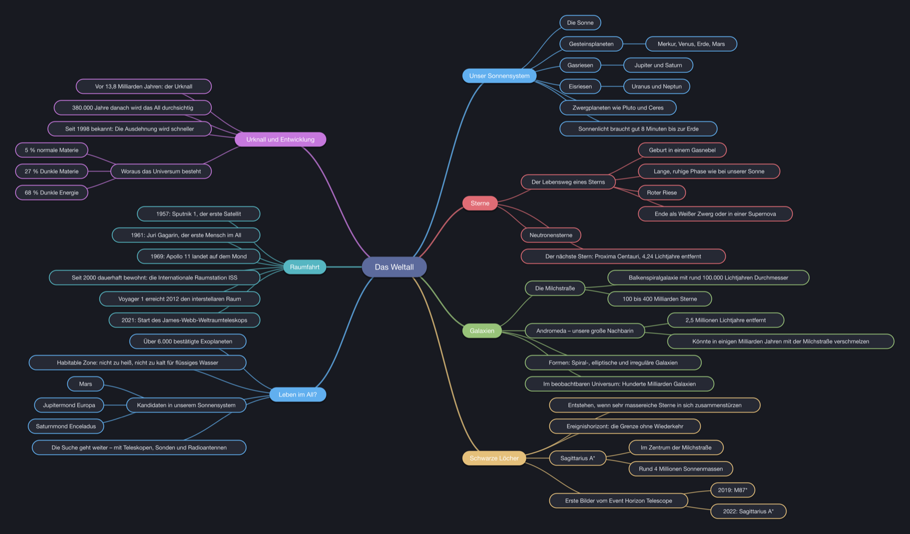

# Mindful

Mindmaps, Markdown und Präsentationen in einer schlanken Desktop-App – geschrieben in Rust mit [egui](https://github.com/emilk/egui).



**Inhalt**

1. [Was Mindful kann](#was-mindful-kann)
2. [Stand je Betriebssystem](#stand-je-betriebssystem)
3. [Wer macht was?](#wer-macht-was)
4. [Für Nutzer:innen: Installieren und loslegen](#für-nutzerinnen-installieren-und-loslegen)
5. [Für Entwickler:innen: Einrichten](#für-entwicklerinnen-einrichten)
6. [Arbeitsablauf im Team](#arbeitsablauf-im-team)
7. [Releases bauen](#releases-bauen)
8. [Bedienung und Tastenkürzel](#bedienung-und-tastenkürzel)
9. [Projektaufbau](#projektaufbau)
10. [Bekannte Grenzen und Ideen](#bekannte-grenzen-und-ideen)

---

## Was Mindful kann

Mindful zeigt **eine Mindmap in drei Ansichten**. Alle drei arbeiten auf denselben Daten, eine Änderung in der einen ist sofort in den anderen sichtbar.

| Ansicht | Wozu |
|---|---|
| **Mindmap** | Gedanken sammeln: Knoten anlegen, ziehen, einfärben, einklappen, automatisch anordnen |
| **Markdown-Editor** | Schnell als Text schreiben: `#` Mitte, `##` Hauptzweige, `-` Unterpunkte, Fließtext als Notiz; mit Live-Vorschau |
| **Präsentation** | Vortragen: Titelfolie plus eine Folie pro Hauptzweig, im Vollbild |

Außerdem:

- Mehrere Mindmaps in Tabs. Beim Beenden wird alles gesichert, auch Ungespeichertes.
- Speichern und Öffnen als `.mindmap`-Datei, Import von Markdown- und Textdateien
- Export als PNG-Bild, SVG-Grafik oder Markdown
- Rückgängig/Wiederholen, Suche, Zoom, Kopieren/Einfügen, Notizen pro Knoten
- 8 Farbschemas (Dunkel ist Standard), darunter Catppuccin; Icons von [Phosphor](https://phosphoricons.com)
- Ein fertiges Beispiel zum Ausprobieren: **Datei → Beispiel öffnen → Weltall**

---

## Stand je Betriebssystem

| System | Status | Fertiges Paket | Hinweise |
|---|---|---|---|
| **macOS, Apple Silicon (M1–M4)** | ✅ entwickelt und getestet | `Mindful.app` über `scripts/build-mac.sh` | Hauptplattform |
| **macOS, Intel** | 🟡 baubar, ungetestet | per Cross-Build vom Apple-Silicon-Mac | siehe [Releases bauen](#releases-bauen) |
| **Windows 10/11** | 🟡 Code vorbereitet, ungetestet | noch keins, `mindful.exe` selbst bauen | Konsolenfenster ist schon abgeschaltet, Icon in der `.exe` fehlt noch |
| **Linux** | 🟡 sollte laufen, ungetestet | noch keins | braucht ein paar Systembibliotheken |

Der Code ist für alle Systeme derselbe. Unterschiede gibt es nur beim Einrichten und beim Bauen des fertigen Pakets.

---

## Wer macht was?

| Rolle | Braucht | Aufgaben |
|---|---|---|
| **Nutzer:in** | Mac (später auch Windows) | App installieren und benutzen, Fehler melden (GitHub → *Issues*) |
| **Entwickler:in** | macOS, Windows oder Linux mit Rust | Funktionen bauen, Fehler beheben, Tests schreiben, Pull Requests stellen |
| **Mac-Release** | einen Mac | `scripts/build-mac.sh` ausführen, `Mindful.app` weitergeben |
| **Windows-Release** | einen Windows-PC (oder Cross-Build) | `mindful.exe` bauen und weitergeben, Windows-Paket aufbauen (offen) |
| **Repo-Verwaltung** (tj537) | GitHub-Zugang | Mitwirkende einladen, Pull Requests freigeben, Sichtbarkeit und Lizenz festlegen |

Eine Person kann natürlich mehrere Rollen haben. Wichtig ist nur: **Ein Mac-Paket lässt sich nur auf einem Mac bauen**, ein Windows-Paket am einfachsten auf Windows.

---

## Für Nutzer:innen: Installieren und loslegen

### macOS

1. `Mindful.app` von der Person bekommen, die das Mac-Release baut, oder [selbst bauen](#macos).
2. In den Ordner **Programme** ziehen, dann bei Bedarf ins Dock.
3. **Beim ersten Start:** Rechtsklick auf die App → **Öffnen** → **Öffnen**.
   Die App ist nur lokal signiert, nicht von Apple beglaubigt. macOS fragt deshalb einmal nach. Danach startet sie normal per Doppelklick.

### Windows

Ein fertiges Paket gibt es noch nicht. Bis dahin [selbst bauen](#windows) und die `mindful.exe` per Rechtsklick → **An Taskleiste anheften**. Beim ersten Start warnt Windows SmartScreen, weil die Datei nicht signiert ist: **Weitere Informationen → Trotzdem ausführen**.

### Wo Mindful Daten ablegt

| Was | macOS | Windows | Linux |
|---|---|---|---|
| Deine Mindmaps | wo du sie speicherst (`.mindmap`) | wo du sie speicherst | wo du sie speicherst |
| Offene Tabs, Farbschema, Fenstergröße | `~/Library/Application Support/Mindful/` | `%APPDATA%\Mindful\data\` | `~/.local/share/mindful/` |

Löschst du den App-Ordner aus der Tabelle, startet Mindful wie neu installiert.

---

## Für Entwickler:innen: Einrichten

Für alle Systeme gilt: Rust wird über **rustup** installiert, die aktuelle stabile Version reicht. Entwickelt wurde mit Rust 1.99.

### macOS

```bash
xcode-select --install
```
Das installiert die Xcode-Kommandozeilenwerkzeuge (Compiler, Linker, `iconutil`, `codesign`). Falls macOS danach beim Bauen meldet, dass die Lizenz nicht akzeptiert ist:
```bash
sudo xcodebuild -license
```
Dann Rust installieren:
```bash
curl --proto '=https' --tlsv1.2 -sSf https://sh.rustup.rs | sh
```

### Windows

1. **Visual Studio Build Tools** installieren ([Download](https://visualstudio.microsoft.com/de/visual-cpp-build-tools/)) und dabei die Arbeitsauslastung **„Desktopentwicklung mit C++“** wählen. Rust braucht daraus den Linker und das Windows-SDK.
2. **Rust** mit `rustup-init.exe` von [rustup.rs](https://rustup.rs) installieren und die Standardeinstellungen übernehmen.
3. **Git** installieren ([git-scm.com](https://git-scm.com)), optional die GitHub-CLI ([cli.github.com](https://cli.github.com)).

Alle Befehle unten funktionieren in PowerShell genauso, nur Pfade schreibt man mit `\`.

### Linux (Debian/Ubuntu)

```bash
sudo apt install build-essential libxcb-render0-dev libxcb-shape0-dev libxcb-xfixes0-dev libxkbcommon-dev zenity
```
```bash
curl --proto '=https' --tlsv1.2 -sSf https://sh.rustup.rs | sh
```
Die Dateidialoge laufen über das Desktop-Portal (`xdg-desktop-portal`), das bei GNOME und KDE normalerweise schon installiert ist. `zenity` braucht es für die Rückfrage beim Schließen ungespeicherter Tabs.

### Projekt holen und starten

Das Repository ist privat. Die Repo-Verwaltung muss dich zuerst einladen (GitHub → *Settings → Collaborators*).

```bash
git clone https://github.com/tj537/mindful.git
```
```bash
cd mindful
```
```bash
cargo run
```

Der erste Build lädt alle Bibliotheken und dauert einige Minuten. Danach geht es in Sekunden.

### Die wichtigsten Befehle

| Befehl | Was er tut |
|---|---|
| `cargo run` | App bauen (Debug) und starten |
| `cargo test` | Alle Tests ausführen |
| `cargo clippy` | Code auf typische Fehler und Stilprobleme prüfen |
| `cargo fmt` | Code einheitlich formatieren |
| `cargo build --release` | Optimierte Version bauen → `target/release/mindful` (Windows: `mindful.exe`) |

---

## Arbeitsablauf im Team

1. **Neuen Branch** für jede Änderung anlegen:
   ```bash
   git switch -c feature/kurzer-name
   ```
2. Ändern, dann vor jedem Commit prüfen:
   ```bash
   cargo fmt && cargo clippy && cargo test
   ```
   Alle drei sollten ohne Warnungen und Fehler durchlaufen. So ist der Stand auf `main`.
3. Committen und hochladen:
   ```bash
   git push -u origin feature/kurzer-name
   ```
4. Auf GitHub einen **Pull Request** gegen `main` öffnen. Die Repo-Verwaltung schaut drüber und führt ihn zusammen.
5. **Plattform-spezifische Änderungen** (Schriften, Dateipfade, Tastenkürzel) möglichst auf dem betroffenen System ausprobieren. Im Code erkennt man sie an `cfg!(target_os = "...")`.

Commit-Nachrichten auf Deutsch, kurz und im Imperativ: „Notizen im Export ergänzen“.

---

## Releases bauen

### macOS

```bash
./scripts/build-mac.sh
```

Das Skript:

1. baut die optimierte Version (`cargo build --release`),
2. rendert das Icon aus `assets/icon.svg` in alle Größen (`examples/make_icon.rs`) und macht daraus eine `.icns`-Datei,
3. stellt `dist/Mindful.app` zusammen (Programm, Icon, `packaging/macos/Info.plist`),
4. signiert das Paket lokal (`codesign --sign -`).

Die Versionsnummer kommt aus `Cargo.toml`. Das Ergebnis läuft auf Macs mit **dem gleichen Prozessortyp** wie der, auf dem gebaut wurde.

**Für Intel-Macs** oder als **Universal-App für beide** zusätzlich:
```bash
rustup target add x86_64-apple-darwin aarch64-apple-darwin
```
```bash
cargo build --release --target x86_64-apple-darwin && cargo build --release --target aarch64-apple-darwin
```
```bash
lipo -create -output target/release/mindful target/x86_64-apple-darwin/release/mindful target/aarch64-apple-darwin/release/mindful
```
Danach die Schritte 2–4 des Skripts von Hand ausführen oder das Skript entsprechend anpassen (offen).

**Weitergabe ohne Rückfrage von macOS** erfordert eine Apple-Developer-ID (99 $/Jahr) und eine Notarisierung bei Apple. Das ist noch nicht eingerichtet.

### Windows

Auf dem Windows-PC im Projektordner:
```powershell
cargo build --release
```
Das Ergebnis ist `target\release\mindful.exe`, eine einzelne Datei ohne weitere Abhängigkeiten. Im Release-Build öffnet sich kein Konsolenfenster daneben.

Noch offen:
- App-Icon in die `.exe` einbetten (z. B. mit dem Crate `winresource` in einer `build.rs`)
- ein Skript `scripts/build-windows.ps1` analog zum Mac-Skript
- optional ein Installer und eine Code-Signatur gegen die SmartScreen-Warnung

### Linux

```bash
cargo build --release
```
Ergebnis: `target/release/mindful`. Ein Paket (AppImage, `.deb`, Flatpak) gibt es noch nicht.

---

## Bedienung und Tastenkürzel

Umschalten zwischen den Ansichten: rechts in der Tableiste oder per Tastenkürzel. **F1** zeigt in der App alle Kürzel.
Auf dem Mac gilt ⌘, unter Windows und Linux Strg.

| Taste | Aktion |
|---|---|
| **Mindmap** | |
| Tab | Unterpunkt anlegen (auch direkt beim Tippen) |
| Enter | Nachbar anlegen / Tippen beenden |
| F2 · Doppelklick | Umbenennen |
| Entf | Knoten samt Unterpunkten löschen |
| Leertaste | Ein- und ausklappen |
| Pfeiltasten | Auswahl bewegen |
| ⌘C · ⌘X · ⌘V · ⌘D | Kopieren · Ausschneiden · Einfügen · Duplizieren |
| ⌘L | Automatisch anordnen |
| ⌘F | Suchen (Enter: nächster Treffer) |
| ⌘0 · ⌘+ · ⌘− | Alles anzeigen · Zoomen |
| Rechtsklick | Menü mit Farbe, Notiz und mehr |
| **Allgemein** | |
| ⌘E | Markdown-Editor ein/aus |
| F5 | Präsentation starten |
| ⌘Z · ⇧⌘Z | Rückgängig · Wiederholen |
| ⌘T · ⌘W | Neuer Tab · Tab schließen |
| Ctrl+Tab · ⌘1…9 | Tab wechseln |
| ⌘S · ⇧⌘S · ⌘O | Speichern · Speichern unter · Öffnen |
| **Präsentation** | |
| → · Leertaste · Klick | Nächste Folie |
| ← · Rechtsklick | Vorherige Folie |
| F · Esc | Vollbild · Beenden |

### Markdown-Format

```markdown
# Titel der Mindmap

Notiz zur Mitte (wird zum Untertitel der Titelfolie).

## Hauptzweig

Notiz zum Zweig (steht auf der Folie unter der Überschrift).

- Unterpunkt
  Notiz zum Unterpunkt
  - noch tiefer
```

---

## Projektaufbau

```
mindful/
├── src/
│   ├── main.rs            Start, Fenster, Icon, Übernahme alter Daten
│   ├── app.rs             Hauptfenster: Menüs, Tabs, Mindmap-Fläche, Tastatur
│   ├── document.rs        Ein Tab: Datei, Ansicht, Rückgängig/Wiederholen
│   ├── model.rs           Mindmap-Daten, Anordnen, Markdown lesen und schreiben
│   ├── markdown_view.rs   Markdown-Editor mit Hervorhebung und Vorschau
│   ├── present.rs         Präsentationsmodus
│   ├── export.rs          SVG- und PNG-Export
│   └── theme.rs           Farbschemas, Schrift, Widget-Stil
├── assets/
│   ├── icon.svg / icon.png    App-Icon (Vorlage / fürs Fenster)
│   └── beispiele/weltall.md   Mitgeliefertes Beispiel
├── examples/make_icon.rs  Rendert das Icon für das Mac-Paket
├── packaging/macos/       Info.plist für Mindful.app
├── scripts/build-mac.sh   Baut dist/Mindful.app
└── docs/                  Architektur und Bilder
```

**Wie das alles zusammenspielt** – Datenmodell, Ablauf eines Frames, Markdown-Abgleich, Dateiformat und wie man neue Funktionen einbaut – steht ausführlich in **[docs/ARCHITEKTUR.md](docs/ARCHITEKTUR.md)**.

### Verwendete Bibliotheken

| Crate | Wofür |
|---|---|
| `eframe` / `egui` 0.31 | Fenster und Oberfläche |
| `egui-phosphor` 0.9 | Icons (Version muss zu egui passen) |
| `rfd` | Native Datei- und Hinweisdialoge |
| `resvg` | SVG in PNG umwandeln (Export, Icon) |
| `serde` / `serde_json` | Speichern und Laden |

---

## Bekannte Grenzen und Ideen

- **Windows-Paket** mit Icon und Build-Skript fehlt noch.
- Das Menü liegt im Fenster, nicht in der macOS-Menüleiste (Eigenheit von egui).
- Doppelklick auf eine `.mindmap`-Datei im Finder öffnet Mindful noch nicht.
- Unter Windows und Linux wird die eingebaute egui-Schrift verwendet, auf dem Mac die Systemschrift (SF).
- Folien zeigen Unterpunkte bis zur dritten Ebene. Notizen von Unterpunkten erscheinen nicht auf den Folien.
- Bei einem Update von egui sind Anpassungen am Code nötig, weil sich dessen Schnittstelle häufig ändert.

## Lizenz

Noch keine festgelegt. Das Repository ist privat. Vor einer Veröffentlichung sollte eine Lizenz gewählt werden (z. B. MIT oder Apache-2.0).
