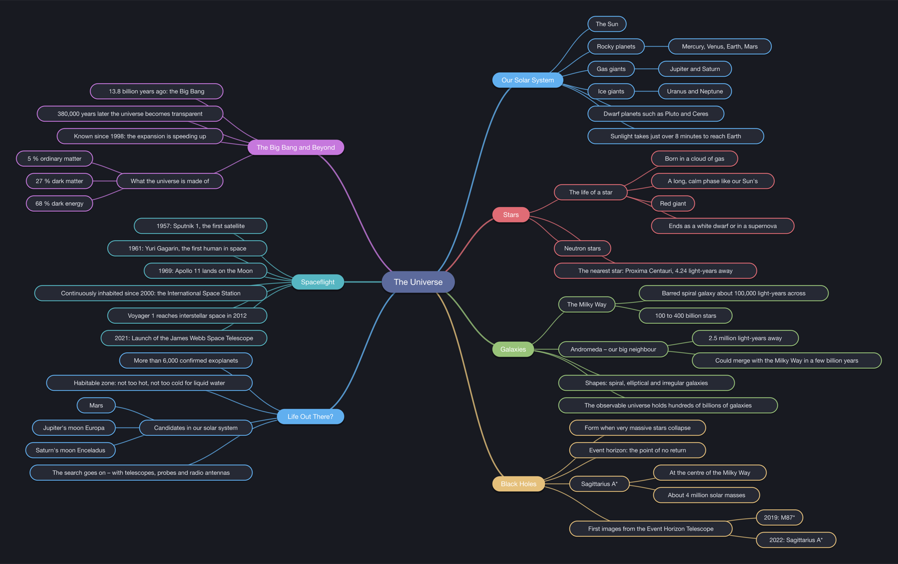

# Mindful

Mind maps, Markdown and presentations in one lightweight desktop app – written in Rust with [egui](https://github.com/emilk/egui).



**Contents**

1. [What Mindful does](#what-mindful-does)
2. [Status per operating system](#status-per-operating-system)
3. [Who does what?](#who-does-what)
4. [For users: install and get started](#for-users-install-and-get-started)
5. [For developers: setup](#for-developers-setup)
6. [Team workflow](#team-workflow)
7. [Building releases](#building-releases)
8. [Usage and keyboard shortcuts](#usage-and-keyboard-shortcuts)
9. [Project structure](#project-structure)
10. [Known limitations and ideas](#known-limitations-and-ideas)

---

## What Mindful does

Mindful shows **one mind map in four views**. All of them work on the same data, so a change in one appears in the others immediately.

| View | What it's for |
|---|---|
| **Markdown editor** | Write quickly as text: `#` central topic, `##` main branches, `-` children, plain text as notes; with live preview |
| **Mind map** | Collect ideas: add nodes, drag them, color them, collapse them, lay them out automatically |
| **Presentation** | Present: a title slide plus one slide per main branch, full screen; bullet points appear one by one |
| **Camera tour** | Present right on the mind map: the camera flies from branch to branch, the current branch is spotlit and its children grow out of it |

Also:

- Several mind maps in tabs. Everything is restored on the next start, including unsaved changes.
- Save and open as `.mindmap` files, import Markdown and plain-text outlines
- Export as PNG image, SVG graphic or Markdown
- **Checkboxes** on any node – written as `- [ ]` / `- [x]` in Markdown; parent nodes show a progress ring, slides and exports show the boxes too
- **Templates**: brainstorming, project plan, SWOT analysis, weekly plan, meeting notes, book summary (**File → New from template**)
- Auto layout with animation: nodes glide to their new places and the view follows smoothly
- Undo/redo, search, zoom, copy/paste, notes on every node
- Presentation effects: slide transitions (slide, fade, zoom, rise), bullet effects (slide in, fade, pop, typewriter), animated backgrounds (aurora, starfield), title animations, slow camera drift in the tour, a laser pointer and a slide strip for jumping around
- 8 themes (Dark is the default), including Catppuccin; icons by [Phosphor](https://phosphoricons.com)
- Ready-made examples to try: **File → Open example → The Universe** (also available in German)

---

## Status per operating system

| System | Status | Ready-made package | Notes |
|---|---|---|---|
| **macOS, Apple silicon (M1–M4)** | ✅ developed and tested | `Mindful.app` via `scripts/build-mac.sh` | main platform |
| **macOS, Intel** | 🟡 builds, untested | cross-build from an Apple-silicon Mac | see [Building releases](#building-releases) |
| **Windows 10/11** | 🟡 code prepared, untested | none yet, build `mindful.exe` yourself | console window already disabled, icon not yet embedded in the `.exe` |
| **Linux** | 🟡 should work, untested | none yet | needs a few system libraries |

The code is the same on every system. Only setup and packaging differ.

---

## Who does what?

| Role | Needs | Tasks |
|---|---|---|
| **User** | a Mac (Windows later) | install and use the app, report bugs (GitHub → *Issues*) |
| **Developer** | macOS, Windows or Linux with Rust | build features, fix bugs, write tests, open pull requests |
| **Mac release** | a Mac | run `scripts/build-mac.sh`, hand out `Mindful.app` |
| **Windows release** | a Windows PC (or a cross-build) | build and hand out `mindful.exe`, set up Windows packaging (open) |
| **Repository admin** (tj537) | GitHub access | invite contributors, review and merge pull requests, decide on visibility and license |

One person can of course have several roles. The important part: **a Mac package can only be built on a Mac**, and a Windows package is easiest to build on Windows.

---

## For users: install and get started

### macOS

1. Get `Mindful.app` from whoever builds the Mac release, or [build it yourself](#macos-2).
2. Drag it into **Applications**, then into the Dock if you like.
3. **On first launch:** right-click the app → **Open** → **Open**.
   The app is only signed locally, not notarized by Apple, so macOS asks once. After that it opens normally with a double-click.

### Windows

There is no ready-made package yet. Until then, [build it yourself](#windows-2) and right-click `mindful.exe` → **Pin to taskbar**. On first launch Windows SmartScreen warns because the file isn't signed: **More info → Run anyway**.

### Where Mindful stores data

| What | macOS | Windows | Linux |
|---|---|---|---|
| Your mind maps | wherever you save them (`.mindmap`) | wherever you save them | wherever you save them |
| Open tabs, theme, window size | `~/Library/Application Support/Mindful/` | `%APPDATA%\Mindful\data\` | `~/.local/share/mindful/` |

Deleting the app folder from this table resets Mindful to a fresh install.

---

## For developers: setup

On every system, Rust is installed via **rustup**. The current stable version is enough. Mindful was developed with Rust 1.99.

### macOS

```bash
xcode-select --install
```
This installs the Xcode command line tools (compiler, linker, `iconutil`, `codesign`). If a build later complains that the license hasn't been accepted:
```bash
sudo xcodebuild -license
```
Then install Rust:
```bash
curl --proto '=https' --tlsv1.2 -sSf https://sh.rustup.rs | sh
```

### Windows

1. Install the **Visual Studio Build Tools** ([download](https://visualstudio.microsoft.com/visual-cpp-build-tools/)) and select the **“Desktop development with C++”** workload. Rust needs its linker and the Windows SDK.
2. Install **Rust** with `rustup-init.exe` from [rustup.rs](https://rustup.rs) and accept the defaults.
3. Install **Git** ([git-scm.com](https://git-scm.com)), and optionally the GitHub CLI ([cli.github.com](https://cli.github.com)).

All commands below work the same in PowerShell; just write paths with `\`.

### Linux (Debian/Ubuntu)

```bash
sudo apt install build-essential libxcb-render0-dev libxcb-shape0-dev libxcb-xfixes0-dev libxkbcommon-dev zenity
```
```bash
curl --proto '=https' --tlsv1.2 -sSf https://sh.rustup.rs | sh
```
File dialogs use the desktop portal (`xdg-desktop-portal`), which GNOME and KDE usually ship already. `zenity` is needed for the prompt when closing a tab with unsaved changes.

### Get the project and run it

The repository is private, so the repository admin has to invite you first (GitHub → *Settings → Collaborators*).

```bash
git clone https://github.com/tj537/mindful.git
```
```bash
cd mindful
```
```bash
cargo run
```

The first build downloads all libraries and takes a few minutes. After that it takes seconds.

### The most important commands

| Command | What it does |
|---|---|
| `cargo run` | build (debug) and start the app |
| `cargo test` | run all tests |
| `cargo clippy` | check the code for common mistakes and style issues |
| `cargo fmt` | format the code consistently |
| `cargo build --release` | build the optimized version → `target/release/mindful` (Windows: `mindful.exe`) |

---

## Team workflow

1. Create a **new branch** for every change:
   ```bash
   git switch -c feature/short-name
   ```
2. Make your changes, then check before every commit:
   ```bash
   cargo fmt && cargo clippy && cargo test
   ```
   All three should finish without warnings or errors – that's the state of `main`.
3. Commit and push:
   ```bash
   git push -u origin feature/short-name
   ```
4. Open a **pull request** against `main` on GitHub. The repository admin reviews and merges it.
5. Try **platform-specific changes** (fonts, file paths, shortcuts) on the affected system if you can. In the code they are marked with `cfg!(target_os = "...")`.

Commit messages in English, short and in the imperative: “Add notes to the export”.

---

## Building releases

### macOS

```bash
./scripts/build-mac.sh
```

The script:

1. builds the optimized version (`cargo build --release`),
2. renders the icon from `assets/icon.svg` in every size (`examples/make_icon.rs`) and turns it into an `.icns` file,
3. assembles `dist/Mindful.app` (binary, icon, `packaging/macos/Info.plist`),
4. signs the bundle locally (`codesign --sign -`).

To build **and install** in one step – replacing `/Applications/Mindful.app` and quitting a running copy first:

```bash
./scripts/build-mac.sh --install
```

Pin the app to the Dock from **/Applications**, not from `dist/`: the Dock icon then always opens the latest build.

The version number comes from `Cargo.toml`. The result runs on Macs with **the same processor type** as the one it was built on.

**For Intel Macs**, or as a **universal app for both**, additionally run:
```bash
rustup target add x86_64-apple-darwin aarch64-apple-darwin
```
```bash
cargo build --release --target x86_64-apple-darwin && cargo build --release --target aarch64-apple-darwin
```
```bash
lipo -create -output target/release/mindful target/x86_64-apple-darwin/release/mindful target/aarch64-apple-darwin/release/mindful
```
Then do steps 2–4 of the script by hand, or extend the script (open).

**Distributing without the macOS warning** requires an Apple Developer ID ($99/year) and notarization by Apple. That isn't set up yet.

### Windows

On the Windows PC, in the project folder:
```powershell
cargo build --release
```
The result is `target\release\mindful.exe`, a single file with no further dependencies. The release build doesn't open a console window next to the app.

Still open:
- embed the app icon in the `.exe` (e.g. with the `winresource` crate in a `build.rs`)
- a `scripts/build-windows.ps1` script like the Mac one
- optionally an installer and code signing to avoid the SmartScreen warning

### Linux

```bash
cargo build --release
```
Result: `target/release/mindful`. There is no package (AppImage, `.deb`, Flatpak) yet.

---

## Usage and keyboard shortcuts

Switch views on the right of the tab bar or with a shortcut. **F1** shows every shortcut inside the app.
On the Mac use ⌘, on Windows and Linux use Ctrl.

| Key | Action |
|---|---|
| **Mind map** | |
| Tab | Add child (also while typing) |
| Enter | Add sibling / finish typing |
| F2 · double-click | Rename |
| Del · Backspace | Delete node and its children |
| Space | Collapse / expand |
| ⌘Enter | Add checkbox / tick it off |
| Arrow keys | Move selection |
| ⌘C · ⌘X · ⌘V · ⌘D | Copy · cut · paste · duplicate |
| ⌘L | Auto layout |
| ⌘F | Find (Enter: next match) |
| ⌘0 · ⌘+ · ⌘− | Fit to window · zoom |
| Right-click | Menu with color, note and more |
| **General** | |
| ⌘E | Toggle Markdown editor |
| F5 | Start presentation |
| F6 | Start camera tour |
| ⌘Z · ⇧⌘Z | Undo · redo |
| ⌘T · ⌘W | New tab · close tab |
| Ctrl+Tab · ⌘1…9 | Switch tab |
| ⌘S · ⇧⌘S · ⌘O | Save · save as · open |
| **Presentation and tour** | |
| → · Space · click | Next bullet point / slide / stop |
| ← · right-click | Back |
| G | Slide strip (also appears at the bottom edge) |
| L | Laser pointer |
| F · Esc | Full screen · end |

### Markdown format

```markdown
# Title of the mind map

Note on the central topic (becomes the subtitle of the title slide).

## Main branch

Note on the branch (shown on the slide below the heading).

- Child
  Note on the child
  - deeper
- [ ] Open task
- [x] Done task
```

---

## Project structure

```
mindful/
├── src/
│   ├── main.rs            startup, window, icon, migration of old data
│   ├── app.rs             main window: menus, tabs, mind map canvas, keyboard
│   ├── document.rs        one tab: file, view, undo/redo
│   ├── model.rs           mind map data, auto layout, reading and writing Markdown
│   ├── markdown_view.rs   Markdown editor with highlighting and preview
│   ├── present.rs         presentation mode (slides)
│   ├── tour.rs            camera tour through the mind map
│   ├── nodes.rs           how nodes look and are drawn (shared)
│   ├── export.rs          SVG and PNG export
│   └── theme.rs           themes, fonts, widget style
├── assets/
│   ├── icon.svg / icon.png    app icon (source / for the window)
│   ├── examples/              bundled examples (English and German)
│   └── templates/             templates for new mind maps
├── examples/make_icon.rs  renders the icon for the Mac bundle
├── packaging/macos/       Info.plist for Mindful.app
├── scripts/build-mac.sh   builds dist/Mindful.app
└── docs/                  architecture and images
```

**How it all fits together** – data model, the flow of a frame, Markdown sync, file format and how to add features – is explained in detail in **[docs/ARCHITECTURE.md](docs/ARCHITECTURE.md)**.

### Libraries

| Crate | Used for |
|---|---|
| `eframe` / `egui` 0.31 | window and user interface |
| `egui-phosphor` 0.9 | icons (version must match egui) |
| `rfd` | native file and message dialogs |
| `resvg` | rendering SVG to PNG (export, icon) |
| `serde` / `serde_json` | saving and loading |

---

## Known limitations and ideas

- A **Windows package** with icon and build script is still missing.
- The menu lives inside the window, not in the macOS menu bar (an egui limitation).
- Double-clicking a `.mindmap` file in Finder doesn't open Mindful yet.
- Windows and Linux use egui's built-in font; the Mac uses the system font (SF).
- Slides show children down to the third level. Notes on children don't appear on slides.
- Updating egui requires code changes because its API changes frequently.
- Code comments are still in German.

## License

Not chosen yet; the repository is private. Pick a license (e.g. MIT or Apache-2.0) before making it public.
