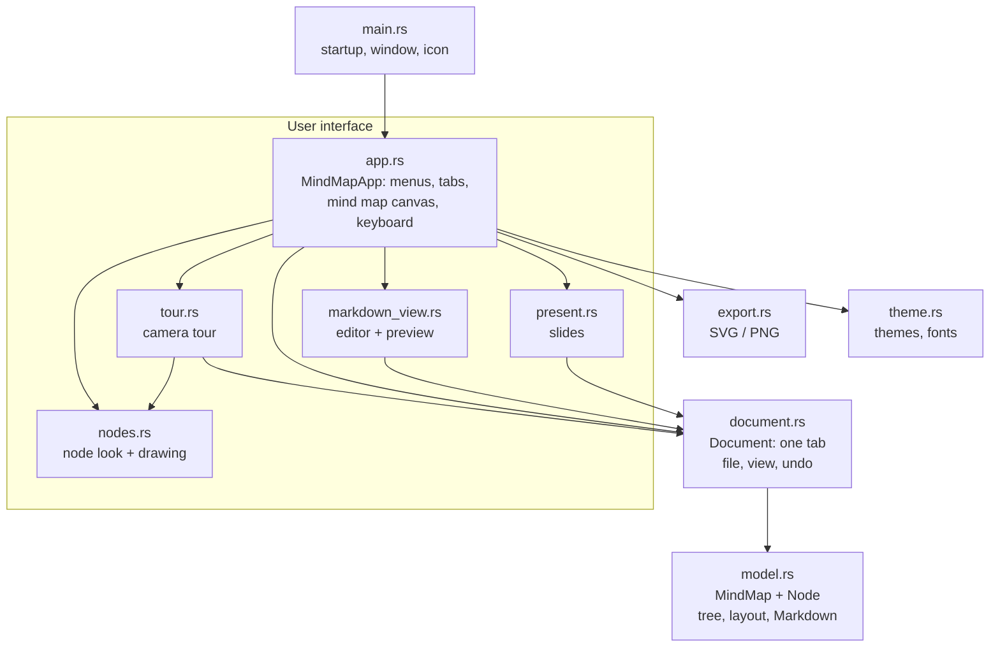
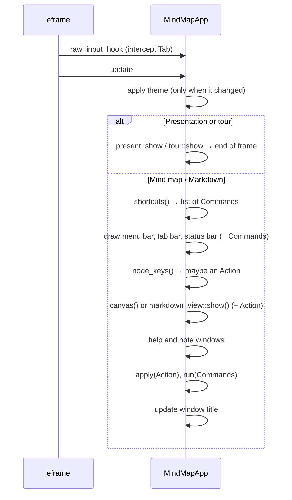
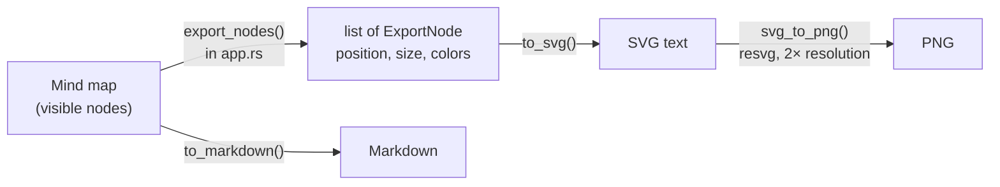

# Mindful architecture

This document explains how Mindful is built inside – for everyone working on the code. Setup and usage are covered in the [README](../README.md).

**Contents**

1. [Overview](#overview)
2. [How egui works](#how-egui-works)
3. [The flow of a frame](#the-flow-of-a-frame)
4. [Commands and actions](#commands-and-actions)
5. [Data model](#data-model-modelrs)
6. [Documents, views, undo](#documents-views-undo-documentrs)
7. [The mind map canvas](#the-mind-map-canvas)
8. [Markdown sync](#markdown-sync)
9. [Presentation](#presentation-presentrs) and [camera tour](#camera-tour-tourrs)
10. [Saving, restoring, file format](#saving-restoring-file-format)
11. [Export](#export-exportrs)
12. [Themes and style](#themes-and-style-themers)
13. [Platform specifics](#platform-specifics)
14. [How do I add …?](#how-do-i-add-)
    (see also [AI prompt](#ai-prompt-ai_promptrs))
15. [Tests](#tests)

---

## Overview

Mindful is split into four layers. Each layer only knows about the ones below it.



| Layer | Files | Depends on egui? |
|---|---|---|
| **Data** | `model.rs` | only `Vec2` as a math helper |
| **Document** | `document.rs` | only `Vec2` |
| **User interface** | `app.rs`, `nodes.rs`, `markdown_view.rs`, `present.rs`, `tour.rs` | yes, fully |
| **Helpers** | `export.rs`, `theme.rs` | colors and geometry |

Data and document barely depend on egui, so switching to a different UI library would mostly affect the UI layer.

---

## How egui works

egui is an **immediate-mode GUI**. There are no long-lived button or window objects. Instead, **the whole interface is described again in every frame** – typically 60 times per second while something is moving. When nothing happens, egui waits for the next input.

```rust
if ui.button("Save").clicked() {
    self.save();
}
```

This line draws the button **and** asks, in the same moment, whether it was clicked. State such as “which node is selected” therefore doesn't live in the UI but in our own structs (`MindMapApp`, `Document`).

---

## The flow of a frame

eframe calls `MindMapApp::update` (`app.rs`) once per frame, with `raw_input_hook` running just before it.



Important: **changes are executed at the end of the frame**, not while drawing. The next section explains why.

---

## Commands and actions

`app.rs` has two enums:

| Type | Used for | Examples |
|---|---|---|
| `Command` | everything that concerns the **app** | new tab, save, export, zoom, switch view |
| `Action` | changes to **nodes** of the active mind map | add child, delete, color, note, paste |

Menus, buttons and shortcuts only return a `Command` or an `Action`. They are executed together at the end of `update` in `run()` and `apply()`.

**Why the detour?** Rust's borrow checker doesn't allow one part of the program to modify data while another part is reading it. Drawing the mind map iterates over all nodes. If a context menu inside that loop deleted a node directly, the compiler would refuse. Collecting first and executing afterwards solves this cleanly, and every change goes through exactly two functions.

---

## Data model (`model.rs`)

### `Node`

| Field | Type | Meaning |
|---|---|---|
| `id` | `u64` | unique within a mind map, never reused |
| `text` | `String` | label |
| `note` | `String` | longer text: Markdown paragraph, slide note, tooltip |
| `pos` | `[f32; 2]` | position relative to the center of the canvas (world coordinates) |
| `parent` | `Option<u64>` | parent node, `None` only for the root |
| `collapsed` | `bool` | children hidden |
| `color` | `Option<usize>` | custom color as an index into the branch colors, inherited by descendants |
| `task` | `Option<bool>` | checkbox: `None` = none, `Some(false)` = open, `Some(true)` = done |

### `MindMap`

```rust
pub struct MindMap {
    pub nodes: Vec<Node>,
    pub next_id: u64,
}
```

The tree is a **flat list with parent references**, not a nested structure. That keeps saving, copying and undo simple. `children(id)` finds children by filtering, and the order in `nodes` defines the order of siblings. For mind maps with a few hundred nodes this is fast enough.

Key functions:

| Function | What it does |
|---|---|
| `add_child`, `remove`, `subtree` | basic tree operations |
| `color_index` | a node's color: its own → inherited from an ancestor → index of its main branch |
| `is_hidden`, `expand_to` | take collapsing into account |
| `neighbor` | nearest node in a direction (arrow keys) |
| `extract`, `insert_subtree`, `clip_json` | copy and paste with new IDs |
| `auto_layout` | automatic layout, see below |
| `task_progress` | done / total checkboxes below a node (for the progress ring) |
| `to_markdown`, `apply_outline`, `parse_outline` | Markdown, see [Markdown sync](#markdown-sync) |

---

## Documents, views, undo (`document.rs`)

A `Document` is one tab. `MindMapApp` holds `docs: Vec<Document>` and the index `active`.

| Field | Saved? | Meaning |
|---|---|---|
| `map` | yes | the mind map |
| `path` | yes | file, once saved |
| `dirty` | yes | unsaved changes (• in the tab) |
| `mode` | yes | `Mindmap`, `Markdown`, `Present` or `Tour` |
| `selected`, `editing` | no | selection, node being renamed |
| `pan`, `zoom` | no | view of the mind map canvas |
| `undo`, `redo` | no | undo history |
| `md_text` | no | text in the Markdown editor |
| `slide`, `build` | no | current slide, number of bullet groups revealed |
| `strip` | no | slide strip pinned open (G) |
| `slide_time` | no | when the current slide appeared (title animation) |
| `tour` | no | camera tour state: current stop, start camera, flight start time |

### Undo and redo

Undo works with **complete copies of the mind map** (snapshots), at most 200 (`UNDO_LIMIT`). With small amounts of data this is simpler and more robust than recording individual edits.

| Method | When |
|---|---|
| `checkpoint()` | **before** every change: pushes the current state onto the stack |
| `record(before)` | **after** a change, when the previous state was kept beforehand (note window) |
| `begin_edit` / `end_edit` | renaming; a text change is only recorded if something actually changed |

New nodes are edited with `begin_edit(id, false)`, so “add and type” together form a single undo step.

### Switching views

`Document::set_mode` handles the transitions:

- **→ Markdown:** generate the text from the mind map (`to_markdown`)
- **→ Presentation:** start at the slide of the selected branch
- **Markdown → Mind map:** fit everything into view on the next frame

Full screen for the presentation is toggled by `MindMapApp::set_mode`, because that needs the egui context.

---

## The mind map canvas

Drawing happens in `MindMapApp::canvas` (`app.rs`).

### Coordinates

Nodes store **world coordinates** (`pos`), independent of zoom and panning. They are converted while drawing:

```
screen = center of canvas + pan + pos × zoom
```

`zoom_at()` zooms so that the point under the mouse stays in place. Zoom ranges from 0.25 to 3.

### One pass of `canvas`

1. If requested: auto layout and/or fit everything into view (`layout_pending`, `fit_pending`)
2. Apply zoom and panning from mouse and trackpad
3. Draw the background with its dot grid
4. Compute size and screen rectangle for every visible node (`Laid`)
5. Draw connections as cubic Bézier curves
6. For each node: handle click, drag and right-click, then draw it (shadow, selection, outline, fill, note icon, counter for collapsed children)
7. While renaming, place a text field over the node
8. Tips card and the context menu of the empty canvas

Node size and look come from `node_style()` in `nodes.rs` (shared with the camera tour): level 0 (central topic) and level 1 (main branches) are filled with color, from level 2 on they are light cards with a colored outline.

### Auto layout

`MindMap::auto_layout` produces the classic mind map picture:

- The first half of the main branches goes to the right, the second half to the left.
- Each subtree gets as much height as its leaves need (`subtree_height`, 54 px per row).
- Horizontal spacing uses the real node widths, which the UI measures and passes in.
- Collapsed subtrees move as a whole.

After auto layout the nodes **glide** from their old to their new positions: `canvas()` stores the old positions in `doc.layout_anim` and draws interpolated positions for 0.7 s, while the data already holds the final ones. *Fit to window* (and the fit after auto layout) moves the view smoothly via `doc.view_anim`; any zoom, scroll or drag by the user cancels it.

### Checkboxes

`nodes.rs` draws them (`paint_task`, `paint_label` for the struck-through text, `paint_checkbox` for free-standing boxes on slides and in the preview) and reserves `TASK_SPACE` on the left of the node. Clicking the box sends `Action::ToggleDone`, ⌘Enter `Action::CycleTask` (none → open → done → open), the context menu `Action::SetTask`.

---

## Markdown sync

### Mapping

| Markdown | Mind map |
|---|---|
| `# Text` | central topic (root) |
| `## Text` | main branch |
| `### Text` etc. | deeper level |
| `- Text` (indented) | child; indentation = level below the last heading |
| plain line | note on the entry above |
| `- [ ] Text` / `- [x] Text` | checkbox, open / done (also works on headings: `## [x] Text`) |

`to_markdown` writes exactly this format. `parse_outline` reads it and understands a bit more: numbered lists, `*`/`+` bullets, checkboxes. If a text contains **no** headings or bullets at all (e.g. pasted from another program), every line becomes a node and indentation decides the level. The indentation width (2 spaces, 4, tab) is detected automatically.

### Live sync without losing data

On **every keystroke** in the editor, `Document::markdown_changed` calls `MindMap::apply_outline`. This must not create a brand-new mind map each time, or positions, colors and collapse states would be lost. So `apply_outline` rebuilds the tree and **recognizes existing nodes**:

1. under the same parent, look for one with **the same text**,
2. otherwise take the node at **the same position** among its siblings,
3. otherwise create a new node.

Recognized nodes keep their ID, position, color and `collapsed`. Because changes arrive one character at a time, this works reliably: when renaming, rule 2 applies; when a line is deleted, the remaining ones find their partners via rule 1.

Undo: the first change of an editor session creates a snapshot, and everything after that belongs to that one step. Inside the text field, its own ⌘Z applies.

---

## AI prompt (`ai_prompt.rs`)

The *AI prompt* button next to the search field opens a popup (`egui::popup::popup_below_widget`) with a small form: topic, language (free text plus quick picks), description, scope and an optional checklist. The form is stored with the app state, so it remembers the last entries.

`build_prompt()` fills these into a fixed English prompt that explains Mindful's Markdown format to the AI – `#` central topic with an intro paragraph, `##` branches with a one-sentence note, short bullets, optional notes and `- [ ]` checkboxes, Markdown only – and ends with a short example. A test makes sure that example is itself valid Mindful Markdown.

*Copy prompt* puts the prompt on the clipboard. *New Markdown tab* opens an empty tab in the Markdown editor and focuses it, ready for pasting the answer; from there the usual Markdown sync turns it into a mind map.

There is no network access: Mindful never talks to an AI itself, the user copies and pastes.

## Presentation (`present.rs`)

`slides()` creates the slides from the mind map:

- **Title slide:** the central topic, its note as a subtitle, the main branches as colored chips
- **One slide per main branch:** heading, note, children down to the third level, in the branch's color

All measurements are relative to a slide 1280 px wide (`s = width / 1280`) and scale with the window. Changing slides is animated with `animate_value_with_time`: the slide glides briefly to the side and fades in or out. With more than eight bullet points the font shrinks.

**Bullet points one by one:** a slide's bullets are split into *groups* – a top-level bullet together with its children. `doc.build` counts how many groups are visible. → reveals the next group before moving to the next slide, ← hides it again. Hidden groups still take up their space so nothing jumps around. The newest group slides in from the left (`doc.build_time`), older ones are dimmed. The behaviour can be switched off under *View → Reveal bullet points one by one*.

**Effects** (`Effects`, stored app-wide in `app.ron`, chosen via the ✨ button while presenting or *View → Presentation effects*):

| Setting | Options | How |
|---|---|---|
| `transition` | Slide, Fade, Zoom, Rise | the slide card is shifted or scaled; all sizes depend on `s`, so scaling the card scales the content |
| `bullets` | Slide in, Fade, Pop, Typewriter | each bullet group gets a start time – the reveal moment, or staggered after the slide appears when bullets aren't revealed one by one |
| `background` | Starfield (default), Aurora, Plain | `backdrop()`: see below |
| `drift`, `bounce` | on/off | tour camera, see below |
| `glow`, `ripple`, `pulses` | on/off | tour effects, see below |
| `step_levels` | on/off | tour: reveal levels one by one |
| `confetti` | on/off | burst of confetti when a checkbox is ticked (slides and tour) |

`Effects::migrate()` brings older saved settings up to date via `version`: version 1 made *Fade* the default transition, version 2 the starfield the default background.

**Starfield:** three layers of pseudo-random stars (`hash()`) – many small faint ones far away, fewer bright ones close by with a soft glow and a sparkle cross. A `parallax` offset moves near stars more than far ones: the tour passes the camera position, slides an animated value that follows the slide number, so the sky shifts a little with every step. Behind the stars two very faint nebula clouds drift in branch colors, and every seven seconds a shooting star crosses the sky.

The title rises and fades in, the accent line draws itself and the chips on the title slide pop in one after another – all timed from `doc.slide_time`.

**Quick jump (G):** `filmstrip()` slides in from the bottom. While it is open, `strip_keys()` turns ← → into moving a cursor (`doc.strip_cursor`) and Enter/Space into jumping there; afterwards – or on Esc/G or a click on a tile – it closes immediately.

**Keyboard only:** slides and stops are changed with the keyboard only (`Nav::next()` = Space, →, Enter; `Nav::left` = ←). Mouse clicks are reserved for ticking checkboxes: visible checkboxes on slides and in the tour are clickable and toggle the node's `task` (with an undo checkpoint). The slide counter shows “x of y done” from `MindMap::task_progress`.

**Settings menu:** the ⚙︎ button in the top right holds the effects and a list of shortcuts, so no hints have to stay on screen.

**Laser pointer (L):** `laser()` hides the cursor and draws a glowing dot with a short trail on the foreground layer.

`present.rs` also holds the parts shared with the tour: `Effects` (with `migrate()` for older saved settings – since version 1, *Fade* is the default transition), `read_nav()` and `strip_keys()` (keys), `corner_buttons()`, `backdrop()`, `filmstrip()`, `laser()` and the easing curves.

## Camera tour (`tour.rs`)

The tour presents directly on the mind map with its own camera (`Camera { center, zoom }` in world coordinates), independent of the editing view.

**Stops:** overview (central topic + main branches) → every main branch → the whole map.

**Flight:** `target()` computes a camera that fits the nodes of a stop into the window (leaving room at the bottom for the subtitle). `fly()` interpolates between the camera at the start of the flight and the target with an ease-in-out curve: the center glides, the zoom changes geometrically, and on long distances the zoom dips out in the middle (*Prezi arc*). If a key is pressed mid-flight, the new flight starts from wherever the camera is right now.

**Growing children:** children of a main branch are hidden until the tour reaches that branch. There they appear level by level (`GROW_STEP` apart), moving out of their parent's position with a slight overshoot (`ease_out_back`). Going backwards shows them instantly.

**Spotlight:** at a branch stop, everything outside that branch is dimmed to 22 %. The brightness blends from the previous stop to the current one during the flight.

**Reveal levels one by one** (`step_levels`): `tour.level` counts how many levels below the current main branch are visible. Space/→ first increases the level – the new level grows out and the camera re-frames the visible levels plus the next one – and only moves on to the next stop once everything is visible. ← hides the last level again; going back to a previous branch shows it fully.

**Glow, ripple, pulses:** nodes in the spotlight get a softly breathing halo; on arrival two rings spread out from the focused node; small lights travel along the connections in the spotlight (`bezier()` gives the point on the curve).

**Camera bounce** (`bounce`): `fly()` adds a small zoom push in the last 30 % of the flight that settles back exactly on the target.

**Camera drift:** with `drift` on, `camera()` slowly zooms in by a few percent and wanders slightly after arriving at a stop (Ken Burns effect), so the picture never stands completely still.

**Subtitle:** the note of the current stop (central topic at the start, the branch afterwards) fades in as a card at the bottom once the camera has arrived.

---

## Saving, restoring, file format

### `.mindmap` file

A `.mindmap` file is the `MindMap` as JSON:

```json
{
  "nodes": [
    {
      "id": 0,
      "text": "The Universe",
      "note": "A journey from our Sun to the edge …",
      "pos": [0.0, 0.0],
      "parent": null,
      "collapsed": false,
      "color": null
    },
    {
      "id": 1,
      "text": "Our Solar System",
      "note": "",
      "pos": [312.0, -180.0],
      "parent": 0,
      "collapsed": false,
      "color": null
    }
  ],
  "next_id": 2
}
```

New fields are introduced with `#[serde(default)]` so that older files without the field still open. Please keep it that way.

### Restoring on startup

eframe calls `App::save` on exit and every 30 seconds. It stores all tabs (`Document`, including unsaved changes and the current view), the theme (by **name**, not index) and the tips setting. This uses eframe's built-in storage (feature `persistence`, file `app.ron`, location in the README). On startup `MindMapApp::new` restores everything, but never starts straight into the presentation.

Two migrations exist from earlier versions:

- `main.rs::migrate_storage` copies the data from the time the app was called “Mindmap” (storage folder `Mindmap`) once.
- German theme names (“Dunkel”, “Hell”, …) are mapped to the English ones when restoring.

---

## Export (`export.rs`)



`ExportNode` contains everything needed in world coordinates, so `export.rs` doesn't have to know anything about the UI. `app.rs` measures node sizes with the egui fonts. The SVG uses Helvetica/Arial, so text widths can differ slightly from the screen.

---

## Themes and style (`theme.rs`)

A `Theme` describes background, grid, card color, text colors, root color, selection color and **six branch colors**. Main branch number *n* gets `branches[n % 6]`.

- `visuals_for(theme)` derives the egui look from it: flat buttons, rounded corners, accent color on hover.
- `apply_spacing` sets spacing and font sizes (the same for all themes).
- `install_fonts` loads the macOS system font if available, plus the Phosphor icons.

Icons are inserted into text as characters: `format!("{}  Save", icon::FLOPPY_DISK)`.

---

## Platform specifics

| Where | What | File |
|---|---|---|
| Shortcuts | `Modifiers::COMMAND` is ⌘ on the Mac, Ctrl elsewhere | `app.rs` |
| “⌘” vs “Ctrl” label | `cfg!(target_os = "macos")` | `help_window` |
| Font | SF only on the Mac, egui default elsewhere | `theme.rs::install_fonts` |
| Console window | hidden on Windows in release builds | `main.rs`, `windows_subsystem` |
| Data folder | chosen by eframe per system | README |
| Mac bundle | `Info.plist`, `.icns`, `codesign` | `packaging/`, `scripts/build-mac.sh` |

**The Tab key:** egui normally uses Tab to jump from button to button. In the mind map, Tab should add a child instead. So `raw_input_hook` intercepts Tab **before** egui sees it. In the Markdown editor Tab is passed through, where it indents. Ctrl+Tab always switches tabs.

---

## How do I add …?

### … a new theme

1. **Append** an entry to `THEMES` in `theme.rs` and increase the array length.
2. Choose `on_accent` so that text on the branch colors stays readable (light pastels → dark text).

It shows up in every menu automatically.

### … a new template

1. Put a Markdown file into `assets/templates/`.
2. Add it to the `TEMPLATES` constant in `app.rs` with a name and an icon.
3. Add it to the `templates_parse_and_round_trip` test.

### … a new example

1. Put a Markdown file into `assets/examples/`.
2. Add it to the `EXAMPLES` constant in `app.rs` (adjust the length).

### … a new menu command with a shortcut

1. Add a variant to `Command` in `app.rs` (or to `Action` if it's about nodes).
2. Handle it in `run()` or `apply()` – the compiler complains until you do.
3. Add a menu entry with `cmd_item(…)` in `menu_bar`.
4. Define the shortcut as `const SC_…` and check it in `shortcuts()`. Check variants **with** Shift before those without.
5. Add it to `help_window` and to the table in the README.

### … a new node field

1. Add the field to `Node`, with `#[serde(default)]`.
2. Initialize it in `Node::new`.
3. Decide whether `to_markdown`/`apply_outline` need to know about it. Recognized nodes keep it there automatically.

### … a new view

1. Add a variant to `Mode` in `document.rs` and its transitions in `Document::set_mode`.
2. Create a file following `markdown_view.rs` with `pub fn show(ui, doc, theme)`.
3. Call it from `MindMapApp::update` and add it to the switcher in `tab_bar`.

---

## Tests

```bash
cargo test
```

| Test | Checks |
|---|---|
| `markdown_round_trip` | Markdown → mind map → Markdown gives the same text |
| `notes_round_trip` | notes under headings and bullets survive |
| `indented_text_with_four_spaces` | indentation width is detected |
| `apply_outline_keeps_existing_nodes` | live sync keeps position and color |
| `paste_subtree_gets_new_ids` | pasting assigns new IDs |
| `auto_layout_puts_branches_left_and_right` | auto layout distributes the branches |
| `collapse_hides_descendants` | collapsing and expanding |
| `checkboxes_round_trip_and_progress` | checkboxes survive Markdown and progress is counted |
| `templates_parse_and_round_trip` | every template parses and comes back unchanged |
| `old_settings_switch_to_fade_once` | older saved effect settings switch to *Fade* and the starfield once |
| `quick_jump_keys` | ← → Enter Esc in the quick-jump strip |
| `prompt_contains_the_inputs` | the AI prompt contains topic, language, description, scope |
| `example_in_the_prompt_is_valid_mindful_markdown` | the format example in the prompt parses and round-trips |
| `universe_example_is_complete` | the English example is complete |
| `weltall_example_is_complete` | the German example is complete |
| `svg_and_png_export` | SVG is escaped correctly, PNG is created |
| `stops_are_overview_branches_finale` | tour stops are in the right order |
| `children_appear_only_from_their_branch_on` | children grow at their branch, show instantly when going back |
| `levels_are_revealed_one_by_one` | level-by-level reveal shows the right nodes and frames the next level |
| `flight_starts_and_ends_on_target_and_arcs_out` | the camera flight hits its targets, zooms out in between and bounces back exactly |

The UI itself has no automated tests. Please try changes there by hand – on macOS **and** Windows if possible.
