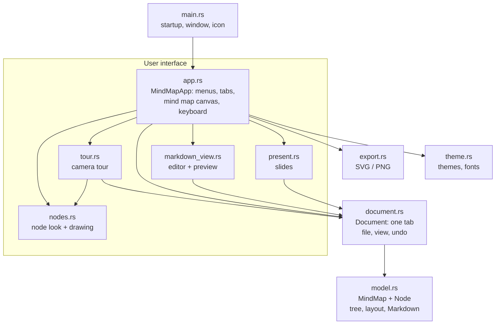
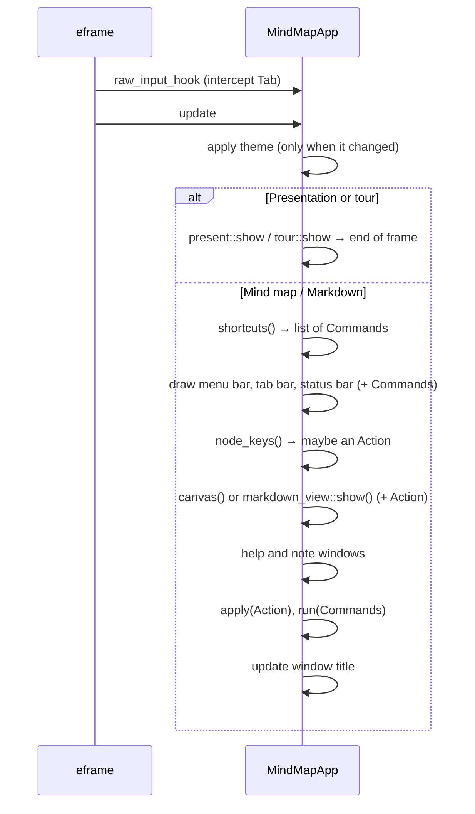
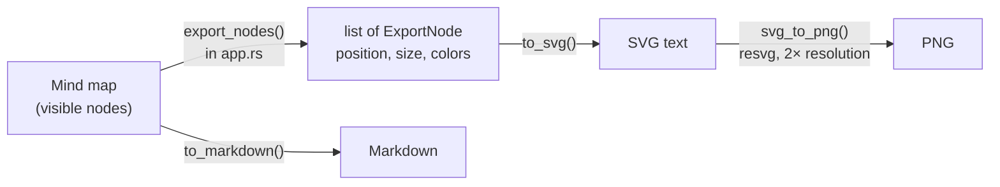

# Mindful architecture

This document explains how Mindful is built inside – for everyone working on the code. Setup and usage are covered in the [README](../README.md).

**Contents**

1. [Overview](#overview)
2. [How egui works](#how-egui-works)
3. [The flow of a frame](#the-flow-of-a-frame)
4. [Commands and actions](#commands-and-actions)
5. [Data model](#data-model-modelrs)
6. [Documents, views, undo](#documents-views-undo-documentrs)
7. [The mind map canvas](#the-mind-map-canvas)
8. [Markdown sync](#markdown-sync)
9. [Presentation](#presentation-presentrs) and [camera tour](#camera-tour-tourrs)
10. [Saving, restoring, file format](#saving-restoring-file-format)
11. [Export](#export-exportrs)
12. [Themes and style](#themes-and-style-themers) · [Search](#search-searchrs)
13. [Platform specifics](#platform-specifics)
14. [How do I add …?](#how-do-i-add-)
    (see also [AI prompt](#ai-prompt-ai_promptrs))
15. [Tests](#tests)

---

## Overview

Mindful is split into four layers. Each layer only knows about the ones below it.



| Layer | Files | Depends on egui? |
|---|---|---|
| **Data** | `model.rs` | only `Vec2` as a math helper |
| **Document** | `document.rs` | only `Vec2` |
| **User interface** | `app.rs`, `nodes.rs`, `markdown_view.rs`, `present.rs`, `tour.rs` | yes, fully |
| **Helpers** | `export.rs`, `theme.rs` | colors and geometry |

Data and document barely depend on egui, so switching to a different UI library would mostly affect the UI layer.

---

## How egui works

egui is an **immediate-mode GUI**. There are no long-lived button or window objects. Instead, **the whole interface is described again in every frame** – typically 60 times per second while something is moving. When nothing happens, egui waits for the next input.

```rust
if ui.button("Save").clicked() {
    self.save();
}
```

This line draws the button **and** asks, in the same moment, whether it was clicked. State such as “which node is selected” therefore doesn't live in the UI but in our own structs (`MindMapApp`, `Document`).

---

## The flow of a frame

eframe calls `MindMapApp::update` (`app.rs`) once per frame, with `raw_input_hook` running just before it. `update` only forwards to `MindMapApp::show(ctx)`, which needs no window – that's what lets the snapshot tests render the whole app.



Important: **changes are executed at the end of the frame**, not while drawing. The next section explains why.

---

## Commands and actions

`app.rs` has two enums:

| Type | Used for | Examples |
|---|---|---|
| `Command` | everything that concerns the **app** | new tab, save, export, zoom, switch view |
| `Action` | changes to **nodes** of the active mind map | add child, delete, color, description / speaker notes (`EditNote(id, NoteKind)`), paste |

Menus, buttons and shortcuts only return a `Command` or an `Action`. They are executed together at the end of `update` in `run()` and `apply()`.

**Why the detour?** Rust's borrow checker doesn't allow one part of the program to modify data while another part is reading it. Drawing the mind map iterates over all nodes. If a context menu inside that loop deleted a node directly, the compiler would refuse. Collecting first and executing afterwards solves this cleanly, and every change goes through exactly two functions.

---

## Data model (`model.rs`)

### `Node`

| Field | Type | Meaning |
|---|---|---|
| `id` | `u64` | unique within a mind map, never reused |
| `text` | `String` | label |
| `note` | `String` | description: Markdown paragraph, text below the slide title, tour subtitle, tooltip |
| `speaker_notes` | `String` | only for the speaker: presenter view and phone remote; `<!-- notes: … -->` in Markdown |
| `callouts` | `Vec<Callout>` | callout boxes (`kind`: note, tip, important, warning, caution; `text`); `> [!TIP]` in Markdown |
| `pos` | `[f32; 2]` | position relative to the center of the canvas (world coordinates) |
| `parent` | `Option<u64>` | parent node, `None` only for the root |
| `collapsed` | `bool` | children hidden |
| `color` | `Option<usize>` | custom color as an index into the branch colors, inherited by descendants |
| `task` | `Option<bool>` | checkbox: `None` = none, `Some(false)` = open, `Some(true)` = done |
| `layout` | `Option<SlideLayout>` | slide layout (main branches only) |
| `image` | `Option<String>` | key of the node's image in `MindMap::images` |

### `MindMap`

```rust
pub struct MindMap {
    pub nodes: Vec<Node>,
    pub next_id: u64,
    pub images: BTreeMap<String, Arc<StoredImage>>,
}
```

`images` holds every inserted picture as `StoredImage { width, height, data }`, where `data` is the encoded JPEG or PNG. They are kept **inside the mind map** so a `.mindmap` file is complete on its own. The `Arc` matters: undo takes a full snapshot of the `MindMap` on every change, and with `Arc` those snapshots share the image bytes instead of copying megabytes. `prune_images` drops pictures no node uses any more; it runs before saving (snapshots still hold their own `Arc`s, so undo keeps working).

The tree is a **flat list with parent references**, not a nested structure. That keeps saving, copying and undo simple. `children(id)` finds children by filtering, and the order in `nodes` defines the order of siblings. For mind maps with a few hundred nodes this is fast enough.

Key functions:

| Function | What it does |
|---|---|
| `add_child`, `remove`, `subtree` | basic tree operations |
| `color_index` | a node's color: its own → inherited from an ancestor → index of its main branch |
| `is_hidden`, `expand_to` | take collapsing into account |
| `neighbor` | nearest node in a direction (arrow keys) |
| `extract`, `insert_subtree`, `clip_json` | copy and paste with new IDs |
| `auto_layout` | automatic layout, see below |
| `task_progress` | done / total checkboxes below a node (shown as “2 of 6 done” on slides) |
| `to_markdown`, `apply_outline`, `parse_outline` | Markdown, see [Markdown sync](#markdown-sync) |
| `to_markdown_with_images`, `from_markdown_with_images` | Markdown plus the image data in a trailing `<!-- mindful-images … -->` block (Markdown export and import) |

---

## Documents, views, undo (`document.rs`)

A `Document` is one tab. `MindMapApp` holds `docs: Vec<Document>` and the index `active`.

| Field | Saved? | Meaning |
|---|---|---|
| `map` | yes | the mind map |
| `path` | yes | file, once saved |
| `dirty` | yes | unsaved changes (• in the tab) |
| `mode` | yes | `Mindmap`, `Markdown`, `Present` or `Tour` |
| `selected`, `editing` | no | selection, node being renamed |
| `pan`, `zoom` | no | view of the mind map canvas |
| `undo`, `redo` | no | undo history |
| `md_text` | no | text in the Markdown editor |
| `slide`, `build` | no | current slide, number of bullet groups revealed |
| `strip` | no | slide strip pinned open (G) |
| `slide_time` | no | when the current slide appeared (title animation) |
| `tour` | no | camera tour state: current stop, start camera, flight start time |

### Undo and redo

Undo works with **complete copies of the mind map** (snapshots), at most 200 (`UNDO_LIMIT`). With small amounts of data this is simpler and more robust than recording individual edits.

| Method | When |
|---|---|
| `checkpoint()` | **before** every change: pushes the current state onto the stack |
| `record(before)` | **after** a change, when the previous state was kept beforehand (note window) |
| `begin_edit` / `end_edit` | renaming; a text change is only recorded if something actually changed |

New nodes are edited with `begin_edit(id, false)`, so “add and type” together form a single undo step.

### Switching views

`Document::set_mode` handles the transitions:

- **→ Markdown:** generate the text from the mind map (`to_markdown`)
- **→ Presentation:** start at the slide of the selected branch
- **Markdown → Mind map:** fit everything into view on the next frame

Full screen for the presentation is toggled by `MindMapApp::set_mode`, because that needs the egui context.

---

## The mind map canvas

Drawing happens in `MindMapApp::canvas` (`app.rs`).

### Coordinates

Nodes store **world coordinates** (`pos`), independent of zoom and panning. They are converted while drawing:

```
screen = center of canvas + pan + pos × zoom
```

`zoom_at()` zooms so that the point under the mouse stays in place. Zoom ranges from 0.25 to 3.

### One pass of `canvas`

1. If requested: auto layout and/or fit everything into view (`layout_pending`, `fit_pending`)
2. Apply zoom and panning from mouse and trackpad
3. Draw the background with its dot grid
4. Compute size and screen rectangle for every visible node (`Laid`)
5. Draw connections as cubic Bézier curves
6. For each node: handle click, drag and right-click, then draw it (shadow, search ring, selection, outline, fill, badges for description and speaker notes, counter for collapsed children)
7. While renaming, place a text field over the node
8. Tips card and the context menu of the empty canvas

Node size and look come from `node_style()` in `nodes.rs` (shared with the camera tour): level 0 (central topic) and level 1 (main branches) are filled with color, from level 2 on they are light cards with a colored outline.

### Auto layout

`MindMap::auto_layout` produces the classic mind map picture:

- The first half of the main branches goes to the right, the second half to the left.
- Each subtree gets as much height as its leaves need (`subtree_height`, 54 px per row, more for nodes with a picture).
- Horizontal spacing uses the real node widths, which the UI measures and passes in.
- Collapsed subtrees move as a whole.

After auto layout the nodes **glide** from their old to their new positions: `canvas()` stores the old positions in `doc.layout_anim` and draws interpolated positions for 0.7 s, while the data already holds the final ones. *Fit to window* (and the fit after auto layout) moves the view smoothly via `doc.view_anim`; any zoom, scroll or drag by the user cancels it.

### Images

Everything about pictures lives in `images.rs`:

- **Importing** (`import`, `import_file`, `from_clipboard`): decode with the `image` crate (SVG via resvg), scale to at most 1920 px, store small JPEGs/PNGs unchanged and re-encode the rest as JPEG (PNG if there is transparency). The key is the file name plus a hash, e.g. `nebula-3fa2c19d.jpg`.
- **Inserting**: dropped files arrive in `ctx.input(|i| i.raw.dropped_files)`; `MindMapApp::drop_target` picks the node under the pointer (from the node rectangles of the last frame), the current slide's branch while presenting, or the selected node. One picture goes onto that node, several become new children. The node menu has *Image → Insert / Paste / Remove*. ⌘V with only an image on the clipboard produces no `Event::Paste` in egui, so `node_keys` watches for the release of V with ⌘ held and then tries `from_clipboard`.
- **Resolving** (`resolve`): `` references that aren't in `images` yet are looked up among the built-in example pictures (`BUILTIN`, compiled in with `include_bytes!`), then as files relative to the document. This runs on opening Markdown, opening an example and when leaving the Markdown editor.
- **Drawing** (`texture`, `paint`): the first draw decodes the picture into an egui texture (with mipmaps) and caches it in egui's temp data by key. `paint` handles *contain* / *cover* fitting, rounded corners, opacity and a zoomed-in crop for the slow zoom.

Nodes with a picture are drawn as a card: `nodes::thumb_size` / `with_thumb` add the thumbnail to the node size, `paint_thumb` draws it and returns the area left for text and checkbox.

### Editing a node

`Action::Rename` (double-click, F2, a new child) opens the text field with the whole text selected, so typing replaces it. A single click opens it straight away if the node still shows a placeholder (`model::is_placeholder`: empty, “New idea” or the “Central topic” of a new tab). Typing while a node is selected but not edited (`Event::Text` in `node_keys`) sends `Action::TypeInto`: the typed characters replace the text and the cursor goes to the end (`edit_cursor_end`). The selection is set through `TextEdit::load_state` / `TextCursorState::set_char_range` right after focusing. `placeholders_can_be_typed_over` in `snapshot.rs` drives this with simulated clicks and keys (`Offscreen::frame_with_events`).

### Checkboxes

`nodes.rs` draws them (`paint_task`, `paint_label` for the struck-through text, `paint_checkbox` for free-standing boxes on slides and in the preview) and reserves `TASK_SPACE` on the left of the node. Clicking the box sends `Action::ToggleDone`, ⌘Enter `Action::CycleTask` (none → open → done → open), the context menu `Action::SetTask`.

---

## Markdown sync

### Mapping

| Markdown | Mind map |
|---|---|
| `# Text` | central topic (root) |
| `## Text` | main branch |
| `### Text` etc. | deeper level |
| `- Text` (indented) | child; indentation = level below the last heading |
| plain line | description of the entry above |
| `<!-- notes: … -->` (one line, or several up to `-->`) | speaker notes of the entry above |
| `> [!NOTE]` / `[!TIP]` / `[!IMPORTANT]` / `[!WARNING]` / `[!CAUTION]` and the `> ` lines below | a callout box of the entry above (a plain `> quote` stays description text) |
| `- [ ] Text` / `- [x] Text` | checkbox, open / done (also works on headings: `## [x] Text`) |

`to_markdown` writes exactly this format (`push_note`, `push_callouts`, then `push_speaker_notes`; a `-->` inside the notes is written as `->` so it can't end the comment). Before classifying, `classify_lines` merges a speaker-notes comment over several lines into one `Line::Notes`, removing only the comment's own indentation, and a callout (`callout_start`, then every following line starting with `>`) into one `Line::Callout`; a `>` line on its own becomes a blank line, so a box can have paragraphs. `parse_outline` reads it and understands a bit more: numbered lists, `*`/`+` bullets, checkboxes. If a text contains **no** headings or bullets at all (e.g. pasted from another program), every line becomes a node and indentation decides the level. The indentation width (2 spaces, 4, tab) is detected automatically.

### Live sync without losing data

On **every keystroke** in the editor, `Document::markdown_changed` calls `MindMap::apply_outline`. This must not create a brand-new mind map each time, or positions, colors and collapse states would be lost. So `apply_outline` rebuilds the tree and **recognizes existing nodes**:

1. under the same parent, look for one with **the same text**,
2. otherwise take the node at **the same position** among its siblings,
3. otherwise create a new node.

Recognized nodes keep their ID, position, color and `collapsed`. Because changes arrive one character at a time, this works reliably: when renaming, rule 2 applies; when a line is deleted, the remaining ones find their partners via rule 1.

Undo: the first change of an editor session creates a snapshot, and everything after that belongs to that one step. Inside the text field, its own ⌘Z applies.

---

## AI prompt (`ai_prompt.rs`)

The *AI prompt* button next to the search field opens a popup (`egui::popup::popup_below_widget`) with a small form: topic, language (free text plus quick picks), description, scope and *Use slide layouts* (on by default). The form is stored with the app state, so it remembers the last entries.

`build_prompt()` fills these into a fixed English prompt that explains Mindful's Markdown format to the AI – `#` central topic with an intro paragraph, `##` branches with a one-sentence note, short bullets, optional descriptions, one `<!-- notes: … -->` line of speaker notes per section, Markdown only – and ends with a short example. With *Use slide layouts*, `LAYOUT_GUIDE` is added: it explains each `<!-- layout -->` tag, what content it suits and how many points and sub-points it expects, so the AI picks fitting diagrams itself (about half of the sections, the rest plain lists); the example then carries a `timeline` tag. A test makes sure that example is itself valid Mindful Markdown.

*Copy prompt* puts the prompt on the clipboard. *New Markdown tab* opens an empty tab in the Markdown editor and focuses it, ready for pasting the answer; from there the usual Markdown sync turns it into a mind map.

There is no network access: Mindful never talks to an AI itself, the user copies and pastes.

## Presentation (`present.rs`)

`slides()` creates the slides from the mind map:

- **Title slide:** the central topic, its note as a subtitle, the main branches as colored chips
- **One slide per main branch:** heading, note, children down to the third level, in the branch's color

**Pictures on slides** (`Slide::images`): the branch's own picture plus every bullet with a picture (its text becomes the caption; a bullet without children of its own then leaves the bullet list). A single picture with no bullets left – or any picture on the title slide – is *full-bleed* (`Slide::full_bleed`): it covers the card, `darken_for_text` lays a gradient mesh over it and the title turns white; with the slow-zoom effect the picture zooms in gently. Otherwise `picture_grid` places the pictures to the right of the bullets (55 / 45 split) or, without bullets, as a gallery: it tries every column count and keeps the one with the largest pictures. Slides with a diagram layout ignore pictures.

All measurements are relative to a slide 1280 px wide (`s = width / 1280`) and scale with the window. Changing slides is animated with `animate_value_with_time`: the slide glides briefly to the side and fades in or out. With more than eight bullet points the font shrinks.

**Bullet points one by one:** a slide's bullets are split into *groups* – a top-level bullet together with its children. `doc.build` counts how many groups are visible. → reveals the next group before moving to the next slide, ← hides it again. Hidden groups still take up their space so nothing jumps around. The newest group slides in from the left (`doc.build_time`), older ones are dimmed. The behaviour can be switched off under *View → Reveal bullet points one by one*.

**Effects** (`Effects`, stored app-wide in `app.ron`, chosen via the ✨ button while presenting or *View → Presentation effects*):

| Setting | Options | How |
|---|---|---|
| `transition` | Slide, Fade, Zoom, Rise | the slide card is shifted or scaled; all sizes depend on `s`, so scaling the card scales the content |
| `bullets` | Slide in, Fade, Pop, Typewriter | each bullet group gets a start time – the reveal moment, or staggered after the slide appears when bullets aren't revealed one by one |
| `background` | Starfield (default), Bokeh, Aurora, Plain | `backdrop()`: see below |
| `shine`, `ken_burns`, `accent_bar` | on/off | slides: light band over the title, slow zoom of the slide card, colored bar on the left (on by default) |
| `vignette` | on/off | darker edges (`vignette()`) |
| `drift`, `bounce` | on/off | tour camera, see below |
| `glow`, `ripple`, `pulses`, `orbit`, `depth_of_field`, `warp` | on/off | tour effects, see below (only `ripple` is on by default) |
| `step_levels` | on/off | tour: reveal levels one by one |
| `confetti` | on/off | burst of confetti when a checkbox is ticked (slides and tour) |

`Effects::migrate()` brings older saved settings up to date via `version`: version 1 made *Fade* the default transition, version 2 the starfield the default background, version 3 switched glow and light pulses to opt-in.

**Starfield:** three layers of pseudo-random stars (`hash()`) – many small faint ones far away, fewer bright ones close by with a soft glow and a sparkle cross. A `parallax` offset moves near stars more than far ones: the tour passes the camera position, slides an animated value that follows the slide number, so the sky shifts a little with every step. Behind the stars two very faint nebula clouds drift in branch colors, and every seven seconds a shooting star crosses the sky.

The title rises and fades in, the accent line draws itself and the chips on the title slide pop in one after another – all timed from `doc.slide_time`.

**Quick jump (G):** `filmstrip()` slides in from the bottom. While it is open, `strip_keys()` turns ← → into moving a cursor (`doc.strip_cursor`) and Enter/Space into jumping there; afterwards – or on Esc/G or a click on a tile – it closes immediately.

**Keyboard only:** slides and stops are changed with the keyboard only (`Nav::next()` = Space, →, Enter; `Nav::left` = ←). Mouse clicks are reserved for ticking checkboxes: visible checkboxes on slides and in the tour are clickable and toggle the node's `task` (with an undo checkpoint). The slide counter shows “x of y done” from `MindMap::task_progress`.

**Settings menu:** the ⚙︎ button in the top right holds the effects and a list of shortcuts, so no hints have to stay on screen.

**Laser pointer (L):** `laser()` hides the cursor and draws a glowing dot with a short trail on the foreground layer.

`present.rs` also holds the parts shared with the tour: `Effects` (with `migrate()` for older saved settings – since version 1, *Fade* is the default transition), `read_nav()` and `strip_keys()` (keys), `corner_buttons()`, `backdrop()`, `filmstrip()`, `laser()` and the easing curves.

## Slide layouts (`diagrams.rs`)

A main branch can have a `layout` (`SlideLayout`). Its slide then shows a diagram instead of a bullet list, built from the same data: every top-level bullet becomes an item, its direct children become sub-text.

| Layout | Drawing |
|---|---|
| `timeline` | numbered circles on a line that fills up step by step, text below |
| `cycle` | rounded boxes on an ellipse; arrows follow the ellipse from where it leaves one box to where it enters the next |
| `pyramid` / `funnel` | stacked trapezoids, narrow at the top or the bottom; children beside each level |
| `compare` | up to four columns with a colored header and a list below |
| `matrix` | 2×2 grid of tinted cards |
| `venn` | two or three overlapping circles; a further item becomes a caption below (what they share) |
| `number` | the first number in the first item, very large, counting up (`split_number`, `format_like` keep decimals and thousands separators of the original), further items as small fact cards |
| `quote` | the first item in italics with a large quotation mark, its first child or the second item as author |
| `bars` | a column chart; values grow and count up item by item, with “nice” grid lines (1, 2 or 5 × 10ⁿ) |
| `pie` | a donut chart whose segments close one after another; the largest share in the middle, a legend with values and percentages beside it |
| `line` | a line that grows from point to point with a light area below, values above the points |

The three charts read their numbers with `parse_datum`: the **last** number in a bullet is the value, the text before it (without a trailing `:`, `–` or `=`) the label, the rest the unit – `Solar: 42 %`, `2015: 1,950`, `Jupiter – 139.8 thousand km`. Values keep the writing of the original while counting up (`Datum::shown`, via `format_like`), and the axis uses the same thousands separator as the data.

`Slide::groups()` asks `SlideLayout::steps()` how many reveal steps a layout has, so diagrams build up exactly like bullet points (`reveal(i)` is the appear progress of item *i*). Choosing a layout: right-click the slide while presenting, right-click a main branch in the mind map (`Action::SetLayout`), or write `<!-- name -->` after the `##` heading – `split_layout()` reads it, `to_markdown()` writes it back.

**Checking how slides look:** `offscreen.rs` runs egui without a window and rasterizes its triangles in software (`Offscreen::frame`, `Offscreen::rgba`). The tests in `snapshot.rs` use it to write PNG files. `cargo test --release render_ -- --ignored` renders every slide of both examples (the examples use every layout once), a tour overview and the whole app window – mind map, Markdown editor, a light theme with an empty map – into `target/snapshots/`. `Offscreen::retina` rasterizes at 2× for sharp screenshots; `MindMapApp::for_snapshot` builds the app without eframe.

### One slide, three places (`render_slide`)

`present::render_slide(ui, card, &SlideView, …)` draws a single slide into a rectangle and returns what was clicked (`SlideOutput`: ticked checkbox, chosen layout, still animating). `SlideView` carries everything that changes between uses – which slide, how many bullet groups are visible, the time stamps for the animations, whether it is clickable (`interactive`) and whether it fills a whole page (`page`, no shadow or rounded corners). It is used by

- the presentation itself (`show`, with the transition and slow zoom applied to the card),
- the **presenter view** (current slide exactly as the audience sees it, next slide fully built),
- the **PDF export** (`draw_static`: fully built, no animation, as a page).

### Presenter view

**P** (or the projector button at the top right while presenting) toggles `doc.presenter`. `presenter_window` then opens a second native window: a timer (`doc.presenter_start`, reset with the button and on every start), the time of day (`chrono`), the position (“slide 5 of 16 · point 2 of 4”), the current and the next slide, and the **speaker notes** of the branch and its bullets (`speaker_notes()` – only `Node::speaker_notes`; the descriptions are on the slide already).

The window is a **deferred viewport** (`ctx.show_viewport_deferred`). An immediate viewport is drawn inside every frame of the main window; with the animated background running at 60 fps both windows then waited for the screen refresh one after the other and the presenter view stuttered. Now the two windows share an `Arc<Mutex<PresenterShared>>` (kept in `ctx.data`): every main frame compares what the presenter view shows with the document (`PresenterState::shows`, no copy) and hands over a new `PresenterState` – and asks the presenter window to repaint – only when something changed. The presenter window repaints on its own for running animations and once a second for the clock. Each window has its own egui clock, so the shared state also carries the main window's time (`PresenterShared::now`). Keys pressed in the presenter window, *Reset* and closing are stored in the shared state, the main window is woken with `request_repaint_of(ViewportId::ROOT)` and picks them up (`Nav::merge`), so you can drive the talk from either window. Closing the window (or P again) turns it off. Where a platform can't open a second window, egui reports `ViewportClass::Embedded` and the view appears as a window inside Mindful instead.

### Phone remote (`remote.rs`)

**R** (or the phone button while presenting) opens a card with a QR code. The first time, `remote::start` launches a tiny HTTP server on port 8765 (or the next free one), listening on all network interfaces, with plain `std::net` and one thread per request. The address is the computer's IP in the local network (found with the UDP “connect without sending” trick) plus a random token, e.g. `http://192.168.1.20:8765/?t=3fa2…`. Requests without the right token get a 403.

- `GET /` serves one self-contained HTML page (`PAGE`): timer, slide title, next slide, speaker notes and two big buttons; it also reacts to swipes and vibrates on tap.
- `GET /state` returns `RemoteState` as JSON; the page polls it every second.
- `POST /next` / `POST /prev` queue a `Command` and wake the UI with `ctx.request_repaint()`.

Every frame `present::show` publishes the current state (`Remote::publish`, without icon glyphs, which the phone's fonts don't have) and turns queued commands into `Nav` presses. The running server is kept in a `Mutex<Option<Arc<Remote>>>`. When the presentation ends (`MindMapApp::set_mode` leaving `Mode::Present`), `remote::stop` sets a flag and connects to its own port once to wake the accept loop, which then exits and closes the port; the next presentation starts a new server with a new token. Start errors are cached for three seconds so the open QR card doesn't retry every frame. The card only shows whether a phone was heard from in the last four seconds.

## PDF export (`pdf.rs`)

*Export → Slides as PDF* runs in a background thread (`MindMapApp::start_pdf_export`; the status bar shows “slide 3 of 16”, polled by `poll_pdf_export`). `pdf::export` creates its own egui context with the app's fonts and theme, renders each slide with `draw_static` at 1280 × 720 points × 1.5 (1920 × 1080 pixels) through `Offscreen`, encodes it as JPEG and writes the pages with a tiny PDF writer of its own (`write_pdf`: catalog, page tree, info, and per page a JPEG image object plus one drawing command). Pages are 960 × 540 pt, like PowerPoint's widescreen format. The text in the PDF is part of the image, so it isn't selectable.

## Camera tour (`tour.rs`)

The tour presents directly on the mind map with its own camera (`Camera { center, zoom }` in world coordinates), independent of the editing view.

**Stops:** overview (central topic + main branches) → every main branch → the whole map.

**Flight:** `target()` computes a camera that fits the nodes of a stop into the window (leaving room at the bottom for the subtitle). `fly()` interpolates between the camera at the start of the flight and the target with an ease-in-out curve: the center glides, the zoom changes geometrically, and on long distances the zoom dips out in the middle (*Prezi arc*). If a key is pressed mid-flight, the new flight starts from wherever the camera is right now.

**Growing children:** children of a main branch are hidden until the tour reaches that branch. There they appear level by level (`GROW_STEP` apart), moving out of their parent's position with a slight overshoot (`ease_out_back`). Going backwards shows them instantly.

**Spotlight:** at a branch stop, everything outside that branch is dimmed to 22 %. The brightness blends from the previous stop to the current one during the flight.

**Reveal levels one by one** (`step_levels`): `tour.level` counts how many levels below the current main branch are visible. Space/→ first increases the level – the new level grows out and the camera re-frames the visible levels plus the next one – and only moves on to the next stop once everything is visible. ← hides the last level again; going back to a previous branch shows it fully.

**Glow, ripple, pulses, sparks:** nodes in the spotlight get a softly breathing halo of many thin layers; on arrival two rings spread out from the focused node; small lights travel along the connections in the spotlight (`bezier()` gives the point on the curve); three sparks orbit the focused node.

**Depth of field:** nodes outside the spotlight shrink by up to 12 % on top of being dimmed.

**Warp streaks:** `TourState::last_cam` keeps the camera of the previous frame. The difference gives the camera's speed and zoom rate, which `backdrop()` turns into streaks – near stars streak more than far ones.

**Camera bounce** (`bounce`): `fly()` adds a small zoom push in the last 30 % of the flight that settles back exactly on the target.

**Camera drift:** with `drift` on, `camera()` slowly zooms in by a few percent and wanders slightly after arriving at a stop (Ken Burns effect), so the picture never stands completely still.

**Subtitle:** the note of the current stop (central topic at the start, the branch afterwards) fades in as a card at the bottom once the camera has arrived.

**Shared parts:** the keys (`navigate`), the subtitle (`subtitle`), the stop label (`stop_label`), the corner buttons, quick-jump strip, vignette, confetti and laser pointer (`controls`) and ticking off (`tick`) are functions of their own, so the second tour style below uses exactly the same controls.

### Free flight (`flight.rs`)

*Effects → Tour → Free flight* (`Effects::tour_style`, `TourStyle::Free`; `tour::show` hands over to `flight::show`) leaves the mind map behind: every stop becomes a card floating in space, and the camera flies through it with a real perspective.

- **Space:** `Vec3` with x to the right, y down and z into the screen. A point at depth `dz` in front of the camera appears at `area.center() + (xy − cam.xy) · focal / dz` with `focal` = window height, so every card scales with its distance. Cards closer than `NEAR` are not drawn.
- **Stations** (`build_world`): the title card, then one per main branch, on a spiral into the depth (`station_center`: x and y on two sine waves, `STEP_Z` = 2600 apart). The sub-points float as cards of their own in two loose columns left and right of their branch card, each with a pseudo-random offset (`hash`), a depth between −170 and +250 (parallax while flying) and a phase for the gentle bobbing. Deeper levels are listed inside these cards (up to five lines, with check marks for tasks); a sub-point with a checkbox can be ticked off directly.
- **Cards** (`layout_card`, `paint_card`): laid out at the current scale – picture, title with icon (`present::title_job`), description, sub-point list – with a soft shadow, a thin border and a coloured bar on top (station) or on the left (sub-point). Layout at scale 1 gives the size in world units, used to place everything.
- **Camera** (`station_camera`): in front of the station at the distance where the whole group fills the usable area. `fly3` glides there with ease-in-out and pulls back and up in an arc on long ways (up to 5200 units), so stations in between rush past. A new flight starts where the camera is (`TourState::from3`); `FLIGHT` is 1.8 s. With *drift* the camera creeps closer and wanders a little after arriving. If the tour switches to this style mid-way, the camera starts at the current stop.
- **Haze:** cards fade out just in front of the camera (we fly through them) and fade into the dark in the distance (`fog`); stops other than the current one are dimmed to 42 %. A faint dotted trail shows the route.
- **Sub-points** appear with the same timing as in the mind map tour (`tour::growth`): they fly out of their card with a slight overshoot.
- **Finale** (`finale`): the title and all branch cards fly from their stations – most of them from behind the camera – into a grid in front of it, staggered one after another. Each row is as tall as its tallest card; pictures are scaled so a card is at most 420 units tall.
- **Background:** the animated backdrop with warp streaks from the camera's speed (`TourState::last_cam3`) – always a little, stronger with *Warp streaks*.

The description is on each card, so there is no subtitle. *Ripple*, *Glow*, *Warp streaks* and *Slow camera drift* apply to both styles; the effects that only make sense on a mind map (levels one by one, pulses, sparks, depth of field, bounce) are only offered for the mind map style.

---

## Callout boxes (`callout.rs`)

GitHub-style alerts – `> [!NOTE]`, `> [!TIP]`, `> [!IMPORTANT]`, `> [!WARNING]`, `> [!CAUTION]` – are `Node::callouts`. `callout::look` gives each kind a fixed colour and Phosphor icon (blue info, green light bulb, purple seal, amber triangle, red octagon), the same in every theme; `callout::fill` the tinted background. `callout::show` draws the box as one paragraph – icon and label in colour, then the text – with a bar on the left and a thin border.

- **Slides** (`render_slide`): the callouts of the branch (or of the central topic on the title slide, `Slide::callouts`) come right after the description and fade in with it; diagrams and bullets move down. A bullet's callouts appear as a smaller box right below it and are revealed with its group. Callouts count as extra lines when the bullet text is made smaller, so a slide doesn't overflow. Diagram layouts show only the branch's callouts.
- **Markdown editor:** the marker line in the kind's colour, the `>` of the following lines too. **Preview:** the real box.
- **Mind map:** *Callout box …* in the right-click menu opens a window with a kind picker and the text for every box of the node (more can be added; empty ones are dropped on closing, `close_note`). The node shows the icon of its first callout in its colour as a badge; the tooltip shows the boxes.
- **Free flight:** the cards draw their callouts below the description (`Piece::Callout`).
- **AI prompt:** asks for a box in about a third of the sections at most; the example has one.

## Search (`search.rs`)

The search box sits in the menu bar (⌘F focuses it). A node matches when its text, description or speaker notes contain the query, ignoring case (`search::hit`, which also says *where*, shown in the status bar as “Match 2 of 5 (in the description)”). `search::ranges` compares char by char, so the byte positions stay those of the original text even after umlauts.

- **While typing** (`Command::FindFirst`) Mindful jumps to the first match; **Enter** (`Command::FindNext`) goes to the next one. `search::hits` lists the matches depth-first in outline order, the same order as in the Markdown text. A jump selects the node, opens collapsed ancestors (`expand_to`) and brings it into view (`doc.reveal`).
- **In the mind map** every match gets a glow and a ring in `nodes::SEARCH` (amber in every theme, at least 1.5 px wide, so it stays visible when zoomed far out), and `search::mark` gives the matching part of the label a background. A collapsed node lights up too when a match is hidden below it.
- **In the Markdown editor** the layouter marks every match the same way; Enter scrolls to the next one (`doc.md_find`, `md_find_scroll`, scrolled with the galley position of that character) while the focus stays in the search box.

## Sound feedback (`sound.rs`)

Off by default; *Settings → Sound feedback* turns it on, with a volume slider and a *Try* button (`sound`, `sound_volume` in the saved state). `MindMapApp::show` passes both to `sound::configure` every frame (two atomics), and `sound::play(Sound::…)` is called where things happen: `Create` in `Action::AddChild`/`AddSibling`, `Delete` in `Action::Delete`, `Done` when a task becomes done, `Whoosh` in `set_mode`, `Swish` when the slide changes (`present::show`) or the tour flies to another stop (`tour::fly_to`). The same sound is played at most every 60 ms, so a held key doesn't pile up.

There are no audio files – `sound::render` computes each sound as 44.1 kHz stereo samples:

| Sound | How it is made |
|---|---|
| `Create` / `Delete` | a sine (plus a little second harmonic) gliding down in pitch, 1.5 ms attack and exponential decay – a soft, woody pop; lower and duller for delete |
| `Done` | two bell tones a fifth apart (880 Hz and 1318.5 Hz, the second 70 ms later), each with a slightly detuned overtone |
| `Whoosh` / `Swish` | white noise (xorshift) through a state-variable band-pass whose centre sweeps up exponentially, with a swell envelope and equal-power panning from left to right |

Every sound ends with a 6 ms fade so it never clicks. Playback runs on a thread of its own (`mindful-sound`), started with the first sound: it opens the default output with `rodio::DeviceSinkBuilder::open_default_sink` and adds each sound to the device's mixer as a `SamplesBuffer`, so sounds can overlap. `rodio` is used with `playback` only (no decoders). Without an output device the thread ends, the next `play` notices the closed channel and switches sound off. Linux builds need `libasound2-dev` (ALSA, installed in CI). `cargo test --release render_ -- --ignored` also writes every sound to `target/snapshots/sounds/*.wav` to listen to.

## Icons on nodes (`icons.rs`)

`Node::icon` holds a short name from `ICONS` (64 entries: name, Phosphor glyph, label). In Markdown it is written as a GitHub-style shortcode before the text – `## :rocket: Spaceflight`, `- :bulb: Idea` – and read back by `split_icon` (unknown names and things like `10:30:` stay text). `nodes::label_job` puts the glyph in front of the label (in the branch colour on outlined nodes), `icons::label` does the same for slides, the preview and the presenter view, and slide titles colour the glyph in the slide colour (`title_job`). The context menu has an *Icon* picker (`icons::picker`, `Action::SetIcon`).

## Settings

The gear at the right end of the top bar opens a popup (`MindMapApp::settings_ui`) with the theme cards, the button for your own colours and the general switches (tips on empty maps, update check). Presentation options stay in *View* and in the ⚙︎ menu while presenting. Everything in it is stored with the app state. New global options belong here rather than in the menus.

## Update check (`update.rs`)

Once per start (if *Settings → Check for updates on startup* is on, stored as `check_updates`) a background thread asks `api.github.com/repos/tj537/mindful/releases/latest` with the system's `curl` – no HTTP library needed. If the tag is newer than `CARGO_PKG_VERSION` (`is_newer` compares `major.minor.patch`), the status bar shows an *Update to x.y.z* button that opens the release page. *Settings → Check now* also reports “up to date” or errors.

## Saving, restoring, file format

### `.mindmap` file

A `.mindmap` file is the `MindMap` as JSON:

```json
{
  "nodes": [
    {
      "id": 0,
      "text": "The Universe",
      "note": "A journey from our Sun to the edge …",
      "pos": [0.0, 0.0],
      "parent": null,
      "collapsed": false,
      "color": null
    },
    {
      "id": 1,
      "text": "Our Solar System",
      "note": "",
      "pos": [312.0, -180.0],
      "parent": 0,
      "collapsed": false,
      "color": null,
      "image": "nebula.jpg"
    }
  ],
  "next_id": 2,
  "images": {
    "nebula.jpg": { "width": 1600, "height": 900, "data": "/9j/4AAQSkZJRg…" }
  }
}
```

Image data is stored as Base64 text (`model::base64_bytes`), not as a list of numbers.

New fields are introduced with `#[serde(default)]` so that older files without the field still open. Please keep it that way.

### Restoring on startup

eframe calls `App::save` on exit and every 30 seconds. It stores all tabs (`Document`, including unsaved changes and the current view), the theme (by **name**, not index) and the tips setting. This uses eframe's built-in storage (feature `persistence`, file `app.ron`, location in the README). On startup `MindMapApp::new` restores everything, but never starts straight into the presentation.

Two migrations exist from earlier versions:

- `main.rs::migrate_storage` copies the data from the time the app was called “Mindmap” (storage folder `Mindmap`) once.
- German theme names (“Dunkel”, “Hell”, …) are mapped to the English ones when restoring.

---

## Export (`export.rs`)



`ExportNode` contains everything needed in world coordinates, so `export.rs` doesn't have to know anything about the UI. `app.rs` measures node sizes with the egui fonts. The SVG uses Helvetica/Arial, so text widths can differ slightly from the screen.

---

## Themes and style (`theme.rs`)

A `Theme` describes background, grid, card color, text colors, root color, selection color and **six branch colors**. Main branch number *n* gets `branches[n % 6]`.

- `visuals_for(theme)` derives the egui look from it: flat buttons, rounded corners, accent color on hover.
- `apply_spacing` sets spacing and font sizes (the same for all themes).
- `install_fonts` loads the macOS system font if available, plus the Phosphor icons.

`THEMES` holds 16 fixed themes; `Theme` is `Copy` and the app always works with `MindMapApp::current_theme()`. The index `THEMES.len()` stands for **your own colours**: `CustomColors` stores background, cards, text, central topic, highlight and the six branch colours (saved with the app state); `to_theme` derives the grid, light/dark and the text colour on coloured nodes (dark on pastel colours, white otherwise). The colour editor (`MindMapApp::color_editor`) changes them live and can start from any built-in theme. Themes are saved by **name**, so names must stay unique (a test checks this).

Icons are inserted into text as characters: `format!("{}  Save", icon::FLOPPY_DISK)`.

### App icon and logo (`logo.rs`)

`assets/icon.svg` is the single source of the Mindful mark: a circle with an **M**, five branches with nodes and square brackets on a white rounded square. Everything else is derived from it:

| Output | Made by |
|---|---|
| macOS `.icns` | `scripts/build-mac.sh` → `cargo run --release --example make_icon -- <dir.iconset>` → `iconutil` |
| `assets/icon.png` (window icon, 256 px) and `assets/icon.ico` (Windows, 16–256 px as PNGs) | `cargo run --release --example make_icon -- --assets` – run it after changing the SVG and commit both files |
| Logo in the menu bar and in the social preview | `logo.rs` at runtime |

The line art sits in the group `<g id="logo">`. `logo::paint` renders only that node with `resvg::render_node` (scaled to the physical pixel size and centred), turns it into a white mask and draws it tinted with the theme's text colour, so the mark follows every theme. Textures are cached per pixel size in `ctx.data`.

---

## Platform specifics

| Where | What | File |
|---|---|---|
| Shortcuts | `Modifiers::COMMAND` is ⌘ on the Mac, Ctrl elsewhere | `app.rs` |
| “⌘” vs “Ctrl” label | `ctx.format_shortcut` for every `KeyboardShortcut` (menus, tooltips); keys that aren't one (⌃Tab, ⌘1…9, ⌫, zoom with scroll, Home/End, the emoji picker) switch on `ctx.os()` | `help_window`, `present::shortcuts_list`, `icons::picker` |
| Font | SF only on the Mac, egui default elsewhere | `theme.rs::install_fonts` |
| Console window | hidden on Windows in release builds | `main.rs`, `windows_subsystem` |
| Data folder | chosen by eframe per system | README |
| Mac bundle | `Info.plist`, `.icns`, `codesign` | `packaging/`, `scripts/build-mac.sh` |
| Windows icon | `assets/icon.ico` embedded into the `.exe` with `winresource` (only when building on Windows) | `build.rs` |
| Window icon | `assets/icon.png` set on the viewport (taskbar, Dock when started without the bundle) | `main.rs` |
| Child processes | `curl` and `cmd /C start` run with `CREATE_NO_WINDOW`, so no console window flashes up | `update.rs` |
| Phone remote | the firewall may ask once whether Mindful may accept connections | `remote.rs` |

**Builds on GitHub:** `.github/workflows/ci.yml` checks formatting (macOS), runs clippy and the tests on macOS, Windows and Linux for every push and pull request. `.github/workflows/release.yml` runs when a `v*` tag is pushed (or by hand with a tag): the macOS job runs `scripts/build-mac.sh --zip`, the Windows job builds `mindful.exe` and zips it as `Mindful.exe`, and the publish job adds `SHA256SUMS.txt` and creates the release – with the notes from `.github/release-notes/<tag>.md` if that file exists – or uploads the files to an existing release. The asset names stay the same in every version, so `releases/latest/download/…` links in the README always point to the newest build.

**The Tab key:** egui normally uses Tab to jump from button to button. In the mind map, Tab should add a child instead. So `raw_input_hook` intercepts Tab **before** egui sees it. In the Markdown editor Tab is passed through, where it indents. Ctrl+Tab always switches tabs.

---

## How do I add …?

### … a new theme

1. **Append** an entry to `THEMES` in `theme.rs` and increase the array length.
2. Choose `on_accent` so that text on the branch colors stays readable (light pastels → dark text).

It shows up in every menu automatically.

### … a new template

1. Put a Markdown file into `assets/templates/`.
2. Add it to the `TEMPLATES` constant in `app.rs` with a name and an icon.
3. Add it to the `templates_parse_and_round_trip` test.

### … a new example

1. Put a Markdown file into `assets/examples/`.
2. Add it to the `EXAMPLES` constant in `app.rs` (adjust the length).
3. Pictures: put them into `assets/examples/images/`, add them to `BUILTIN` in `images.rs` and reference them by file name, e.g. ``. The space pictures are generated by `cargo run --release --example make_space_images`.

### … a new menu command with a shortcut

1. Add a variant to `Command` in `app.rs` (or to `Action` if it's about nodes).
2. Handle it in `run()` or `apply()` – the compiler complains until you do.
3. Add a menu entry with `cmd_item(…)` in `menu_bar`.
4. Define the shortcut as `const SC_…` and check it in `shortcuts()`. Check variants **with** Shift before those without.
5. Add it to `help_window` and to the table in the README.

### … a new node field

1. Add the field to `Node`, with `#[serde(default)]`.
2. Initialize it in `Node::new`.
3. Decide whether `to_markdown`/`apply_outline` need to know about it. Recognized nodes keep it there automatically.

### … a new view

1. Add a variant to `Mode` in `document.rs` and its transitions in `Document::set_mode`.
2. Create a file following `markdown_view.rs` with `pub fn show(ui, doc, theme)`.
3. Call it from `MindMapApp::show` and add it to `mode_switch` in `app.rs`.

---

## Tests

```bash
cargo test
```

| Test | Checks |
|---|---|
| `markdown_round_trip` | Markdown → mind map → Markdown gives the same text |
| `notes_round_trip` | notes under headings and bullets survive |
| `indented_text_with_four_spaces` | indentation width is detected |
| `apply_outline_keeps_existing_nodes` | live sync keeps position and color |
| `paste_subtree_gets_new_ids` | pasting assigns new IDs |
| `auto_layout_puts_branches_left_and_right` | auto layout distributes the branches |
| `collapse_hides_descendants` | collapsing and expanding |
| `slide_layouts_in_markdown` | layout comments are read and written back |
| `numbers_are_split_and_formatted_like_the_original` | big-number layout: splitting and count-up formatting (English and German) |
| `render_slides` (ignored, run on demand) | renders every slide of both examples, the presenter view and a tour overview to PNG for a visual check |
| `callouts_round_trip_under_headings_and_bullets` | `> [!TIP]` boxes (with paragraphs, several per node, under headings and bullets) are read and written back exactly; a plain quote stays text; the tag ignores case |
| `speaker_notes_round_trip_apart_from_the_description` | `<!-- notes: … -->` (one line and a block, under headings and bullets) is read into `speaker_notes`, kept apart from the description, survives editing and is written back exactly |
| `free_flight_arcs_and_lands_exactly` | the free-flight camera starts and lands exactly, pulls back and rises half way; stations lie deeper and deeper |
| `every_branch_becomes_a_station_with_floating_sub_points` | the universe example gives the title plus 16 stations, the sub-points float beside their card, and the finale grid has a place in front of the camera for every card |
| `sounds_are_short_quiet_and_end_softly` | every sound is 0.05–0.6 s long, peaks between 0.02 and 0.5, ends without a click; the whoosh moves from left to right; with sound off nothing starts |
| `matches_ignore_case_and_find_notes` | search ignores case, keeps byte positions after umlauts, finds text, description and speaker notes in outline order and marks only the match in a `LayoutJob` |
| `icons_are_read_from_shortcodes` | `:rocket: Text` becomes an icon, unknown names stay text |
| `logo_is_found_in_the_app_icon` | `assets/icon.svg` has a `logo` group that renders without the icon background |
| `versions_are_compared` | update check: `v0.3.0` is newer than `0.2.0`, nonsense is ignored |
| `phone_requests_need_the_token_and_queue_commands` | the remote server rejects wrong tokens, serves the page and state, queues Next |
| `placeholders_can_be_typed_over` | simulated click + typing replaces a placeholder; typing on a selected node replaces its text |
| `chart_points_are_read_from_bullets` | “Solar: 42 %” etc. give label, value and unit |
| `slides_become_pdf_pages` | the PDF has one image page per slide and a correct cross-reference table |
| `render_app` (ignored, run on demand) | renders the whole window (mind map, Markdown, light theme, empty map) to PNG |
| `images_round_trip_and_travel_with_the_file` | image lines survive Markdown; image data travels in the Markdown block, the JSON file and the clipboard; unused images are dropped |
| `large_images_are_scaled_and_stored_as_jpeg` | big pictures are scaled to 1920 px and re-encoded |
| `builtin_example_images_resolve` | example pictures are found inside the app |
| `checkboxes_round_trip_and_progress` | checkboxes survive Markdown and progress is counted |
| `templates_parse_and_round_trip` | every template parses and comes back unchanged |
| `old_settings_switch_to_fade_once` | older saved effect settings switch to *Fade* and the starfield once |
| `quick_jump_keys` | ← → Enter Esc in the quick-jump strip |
| `prompt_contains_the_inputs` | the AI prompt contains topic, language, description, scope |
| `example_in_the_prompt_is_valid_mindful_markdown` | the format example in the prompt parses and round-trips |
| `universe_example_is_complete` | the English example is complete, uses every slide layout once and has its five pictures |
| `weltall_example_is_complete` | the German example is complete |
| `svg_and_png_export` | SVG is escaped correctly, PNG is created |
| `stops_are_overview_branches_finale` | tour stops are in the right order |
| `children_appear_only_from_their_branch_on` | children grow at their branch, show instantly when going back |
| `levels_are_revealed_one_by_one` | level-by-level reveal shows the right nodes and frames the next level |
| `flight_starts_and_ends_on_target_and_arcs_out` | the camera flight hits its targets, zooms out in between and bounces back exactly |

The UI itself has no automated tests. Please try changes there by hand – on macOS **and** Windows if possible.
