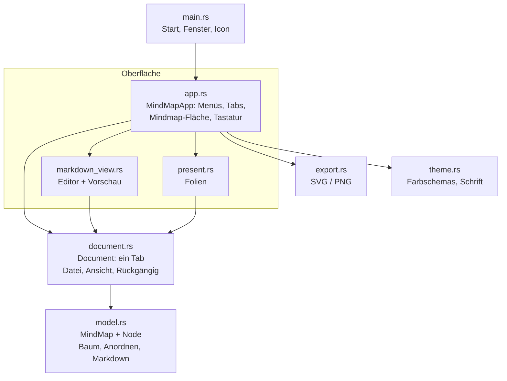
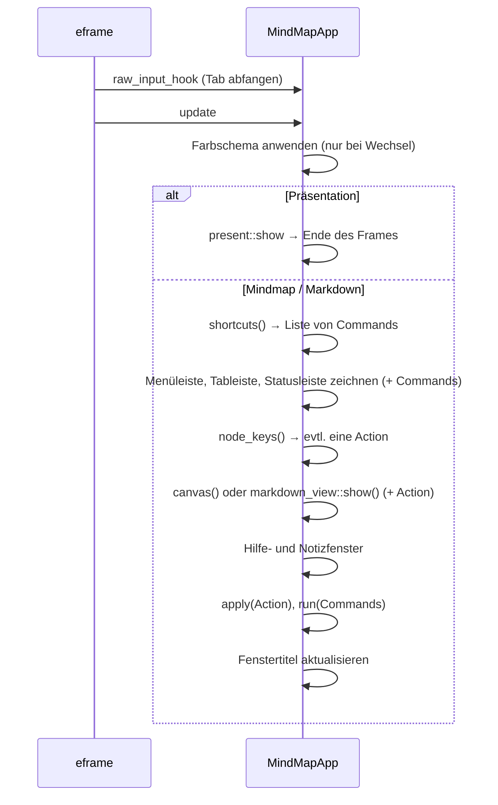
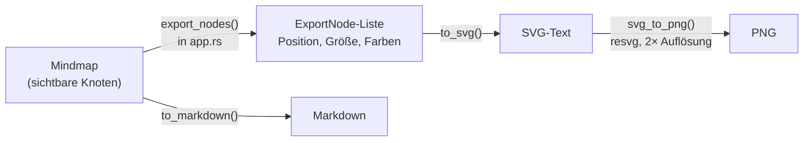

# Architektur von Mindful

Dieses Dokument erklärt, wie Mindful innen aufgebaut ist: für alle, die am Code arbeiten. Einrichtung und Bedienung stehen in der [README](../README.md).

**Inhalt**

1. [Überblick](#überblick)
2. [Wie egui funktioniert](#wie-egui-funktioniert)
3. [Ablauf eines Frames](#ablauf-eines-frames)
4. [Befehle und Aktionen](#befehle-und-aktionen)
5. [Datenmodell](#datenmodell-modelrs)
6. [Dokumente, Ansichten, Rückgängig](#dokumente-ansichten-rückgängig-documentrs)
7. [Die Mindmap-Fläche](#die-mindmap-fläche)
8. [Markdown-Abgleich](#markdown-abgleich)
9. [Präsentation](#präsentation-presentrs)
10. [Speichern, Wiederherstellen, Dateiformat](#speichern-wiederherstellen-dateiformat)
11. [Export](#export-exportrs)
12. [Farbschemas und Stil](#farbschemas-und-stil-themers)
13. [Plattform-Besonderheiten](#plattform-besonderheiten)
14. [Wie baue ich … ein?](#wie-baue-ich--ein)
15. [Tests](#tests)

---

## Überblick

Mindful ist in vier Schichten aufgeteilt. Jede Schicht kennt nur die darunter.



| Schicht | Dateien | Weiß von egui? |
|---|---|---|
| **Daten** | `model.rs` | nur `Vec2` als Rechenhilfe |
| **Dokument** | `document.rs` | nur `Vec2` |
| **Oberfläche** | `app.rs`, `markdown_view.rs`, `present.rs` | ja, komplett |
| **Hilfen** | `export.rs`, `theme.rs` | Farben und Geometrie |

Daten und Dokument hängen fast nicht von egui ab. Ein Wechsel der Oberflächen-Bibliothek würde also vor allem die Oberflächen-Schicht betreffen.

---

## Wie egui funktioniert

egui ist eine **Immediate-Mode-GUI**. Es gibt keine dauerhaften Button- oder Fenster-Objekte. Stattdessen wird die **komplette Oberfläche in jedem Frame neu beschrieben**, typischerweise 60-mal pro Sekunde, solange sich etwas bewegt. Ist nichts zu tun, wartet egui auf die nächste Eingabe.

```rust
if ui.button("Speichern").clicked() {
    self.save();
}
```

Diese Zeile zeichnet den Button **und** fragt im selben Moment, ob er geklickt wurde. Zustand wie „welcher Knoten ist ausgewählt“ liegt deshalb nicht in der Oberfläche, sondern in unseren eigenen Strukturen (`MindMapApp`, `Document`).

---

## Ablauf eines Frames

eframe ruft pro Frame `MindMapApp::update` auf (`app.rs`). Davor läuft `raw_input_hook`.



Wichtig: **Änderungen werden erst am Ende des Frames ausgeführt**, nicht mitten im Zeichnen. Warum, steht im nächsten Abschnitt.

---

## Befehle und Aktionen

In `app.rs` gibt es zwei Aufzählungen:

| Typ | Wofür | Beispiele |
|---|---|---|
| `Command` | alles, was die **App** betrifft | Neuer Tab, Speichern, Export, Zoom, Ansicht wechseln |
| `Action` | Änderungen an **Knoten** der aktiven Mindmap | Unterpunkt anlegen, Löschen, Farbe, Notiz, Einfügen |

Menüs, Buttons und Tastenkürzel liefern nur einen `Command` oder eine `Action` zurück. Ausgeführt werden sie gesammelt am Ende von `update` in `run()` bzw. `apply()`.

**Warum so umständlich?** Rusts Borrow-Checker erlaubt nicht, dass ein Programmteil Daten verändert, während ein anderer sie gerade liest. Beim Zeichnen der Mindmap wird über alle Knoten iteriert. Würde ein Rechtsklick-Menü in dieser Schleife direkt einen Knoten löschen, verweigert der Compiler das. Erst sammeln, dann ausführen löst das sauber, und alle Änderungen laufen über genau zwei Funktionen.

---

## Datenmodell (`model.rs`)

### `Node`

| Feld | Typ | Bedeutung |
|---|---|---|
| `id` | `u64` | eindeutig innerhalb einer Mindmap, wird nie wiederverwendet |
| `text` | `String` | Beschriftung |
| `note` | `String` | längerer Text: Markdown-Absatz, Folien-Notiz, Tooltip |
| `pos` | `[f32; 2]` | Position relativ zur Mitte der Fläche (Weltkoordinaten) |
| `parent` | `Option<u64>` | Elternknoten, `None` nur bei der Wurzel |
| `collapsed` | `bool` | Unterpunkte verborgen |
| `color` | `Option<usize>` | eigene Farbe als Index in die Zweigfarben, vererbt sich nach unten |

### `MindMap`

```rust
pub struct MindMap {
    pub nodes: Vec<Node>,
    pub next_id: u64,
}
```

Der Baum ist eine **flache Liste mit Eltern-Verweisen**, keine verschachtelte Struktur. Das macht Speichern, Kopieren und Rückgängig einfach. Kinder findet `children(id)` durch Filtern. Die Reihenfolge in `nodes` bestimmt die Reihenfolge der Geschwister. Für Mindmaps mit einigen Hundert Knoten ist das schnell genug.

Wichtige Funktionen:

| Funktion | Was sie tut |
|---|---|
| `add_child`, `remove`, `subtree` | Grundoperationen am Baum |
| `color_index` | Farbe eines Knotens: eigene → von Vorfahren geerbt → Nummer des Hauptzweigs |
| `is_hidden`, `expand_to` | Einklappen berücksichtigen |
| `neighbor` | nächster Knoten in einer Richtung (Pfeiltasten) |
| `extract`, `insert_subtree`, `clip_json` | Kopieren und Einfügen mit neuen IDs |
| `auto_layout` | automatisch anordnen, siehe unten |
| `to_markdown`, `apply_outline`, `parse_outline` | Markdown, siehe [Markdown-Abgleich](#markdown-abgleich) |

---

## Dokumente, Ansichten, Rückgängig (`document.rs`)

Ein `Document` ist ein Tab. `MindMapApp` hält `docs: Vec<Document>` und den Index `active`.

| Feld | Gespeichert? | Bedeutung |
|---|---|---|
| `map` | ja | die Mindmap |
| `path` | ja | Datei, falls schon gespeichert |
| `dirty` | ja | ungespeicherte Änderungen (• im Tab) |
| `mode` | ja | `Mindmap`, `Markdown` oder `Present` |
| `selected`, `editing` | nein | Auswahl, gerade bearbeiteter Knoten |
| `pan`, `zoom` | nein | Ansicht der Mindmap-Fläche |
| `undo`, `redo` | nein | Rückgängig-Verlauf |
| `md_text` | nein | Text im Markdown-Editor |
| `slide` | nein | aktuelle Folie |

### Rückgängig und Wiederholen

Rückgängig arbeitet mit **ganzen Kopien der Mindmap** (Snapshots), höchstens 200 Stück (`UNDO_LIMIT`). Bei kleinen Datenmengen ist das einfacher und robuster als einzelne Änderungsschritte.

| Methode | Wann |
|---|---|
| `checkpoint()` | **vor** jeder Änderung: legt den aktuellen Stand auf den Stapel |
| `record(before)` | **nach** einer Änderung, wenn der vorherige Stand vorher gemerkt wurde (Notizfenster) |
| `begin_edit` / `end_edit` | Umbenennen; eine Textänderung wird nur gemerkt, wenn sich wirklich etwas geändert hat |

Neue Knoten werden mit `begin_edit(id, false)` bearbeitet. So sind „Anlegen und Text eintippen“ zusammen ein einziger Rückgängig-Schritt.

### Ansichten wechseln

`Document::set_mode` kümmert sich um die Übergänge:

- **→ Markdown:** Text aus der Mindmap erzeugen (`to_markdown`)
- **→ Präsentation:** bei der Folie des ausgewählten Zweigs beginnen
- **Markdown → Mindmap:** beim nächsten Zeichnen alles ins Bild holen

Vollbild für die Präsentation schaltet `MindMapApp::set_mode`, weil dafür der egui-Kontext nötig ist.

---

## Die Mindmap-Fläche

Gezeichnet wird in `MindMapApp::canvas` (`app.rs`).

### Koordinaten

Knoten speichern **Weltkoordinaten** (`pos`), unabhängig von Zoom und Verschiebung. Umgerechnet wird beim Zeichnen:

```
Bildschirm = Mitte der Fläche + pan + pos × zoom
```

`zoom_at()` zoomt so, dass der Punkt unter der Maus an seiner Stelle bleibt. Der Zoom liegt zwischen 0,25 und 3.

### Ein Durchlauf von `canvas`

1. Falls angefordert: automatisch anordnen und/oder alles ins Bild holen (`layout_pending`, `fit_pending`)
2. Zoom und Verschieben aus Maus und Trackpad übernehmen
3. Hintergrund mit Punktraster zeichnen
4. Für alle sichtbaren Knoten Größe und Bildschirm-Rechteck berechnen (`Laid`)
5. Verbindungen als kubische Bezier-Kurven zeichnen
6. Für jeden Knoten: Klick, Ziehen und Rechtsklick abfragen, dann zeichnen (Schatten, Auswahl, Rand, Füllung, Notiz-Symbol, Zähler für Eingeklapptes)
7. Beim Bearbeiten ein Textfeld über den Knoten legen
8. Tipp-Karte und Rechtsklick-Menü der freien Fläche

Knotengröße und Aussehen kommen aus `node_style()`: Ebene 0 (Mitte) und 1 (Hauptzweige) sind farbig gefüllt, ab Ebene 2 helle Karten mit farbigem Rand.

### Automatisch anordnen

`MindMap::auto_layout` erzeugt das klassische Mindmap-Bild:

- Die erste Hälfte der Hauptzweige kommt rechts, die zweite links.
- Jeder Teilbaum bekommt so viel Höhe, wie seine Blätter brauchen (`subtree_height`, 54 px pro Zeile).
- Der waagerechte Abstand richtet sich nach den echten Knotenbreiten, die die Oberfläche vorher misst und übergibt.
- Eingeklappte Teilbäume wandern als Ganzes mit.

---

## Markdown-Abgleich

### Zuordnung

| Markdown | Mindmap |
|---|---|
| `# Text` | Mitte (Wurzel) |
| `## Text` | Hauptzweig |
| `### Text` usw. | tiefere Ebene |
| `- Text` (eingerückt) | Unterpunkt; Einrückung = Ebene unterhalb der letzten Überschrift |
| normale Zeile | Notiz zum Eintrag davor |

`to_markdown` schreibt genau dieses Format. `parse_outline` liest es, kann aber noch mehr: nummerierte Listen, `*`/`+` als Aufzählung, Checkboxen. Enthält ein Text **gar keine** Überschriften oder Aufzählungen (z. B. eingefügt aus einem anderen Programm), gilt jede Zeile als Knoten und die Einrückung bestimmt die Ebene. Die Einrückungsweite (2 Leerzeichen, 4, Tab) wird automatisch erkannt.

### Live-Abgleich ohne Datenverlust

Bei **jedem Tastendruck** im Editor ruft `Document::markdown_changed` `MindMap::apply_outline` auf. Dabei soll nicht jedes Mal eine neue Mindmap entstehen, denn sonst gingen Positionen, Farben und Einklapp-Zustände verloren. Deshalb baut `apply_outline` den Baum neu auf und **erkennt bestehende Knoten wieder**:

1. unter demselben Elternknoten einen mit **gleichem Text** suchen,
2. sonst den Knoten an **derselben Stelle** in der Geschwister-Reihenfolge nehmen,
3. sonst einen neuen Knoten anlegen.

Wiedererkannte Knoten behalten ID, Position, Farbe und `collapsed`. Weil Änderungen Zeichen für Zeichen ankommen, klappt das zuverlässig: Beim Umbenennen greift Regel 2, beim Löschen einer Zeile finden die übrigen ihre Partner über Regel 1.

Rückgängig: Die erste Änderung einer Editor-Sitzung legt einen Snapshot an. Alles danach gehört zu diesem einen Schritt. Innerhalb des Textfelds gilt dessen eigenes ⌘Z.

---

## Präsentation (`present.rs`)

`slides()` erzeugt die Folien aus der Mindmap:

- **Titelfolie:** Text der Mitte, ihre Notiz als Untertitel, Hauptzweige als farbige Marken
- **eine Folie pro Hauptzweig:** Überschrift, Notiz, Unterpunkte bis zur dritten Ebene, in der Farbe des Zweigs

Alle Maße sind relativ zu einer Folie mit 1280 px Breite (`s = Breite / 1280`) und skalieren mit dem Fenster. Der Folienwechsel ist mit `animate_value_with_time` animiert: Die Folie gleitet kurz zur Seite und wird dabei ein- bzw. ausgeblendet. Bei mehr als acht Punkten wird die Schrift verkleinert.

---

## Speichern, Wiederherstellen, Dateiformat

### `.mindmap`-Datei

Eine `.mindmap`-Datei ist die `MindMap` als JSON:

```json
{
  "nodes": [
    {
      "id": 0,
      "text": "Das Weltall",
      "note": "Eine Reise von unserer Sonne bis an den Rand …",
      "pos": [0.0, 0.0],
      "parent": null,
      "collapsed": false,
      "color": null
    },
    {
      "id": 1,
      "text": "Unser Sonnensystem",
      "note": "",
      "pos": [312.0, -180.0],
      "parent": 0,
      "collapsed": false,
      "color": null
    }
  ],
  "next_id": 2
}
```

Neue Felder werden mit `#[serde(default)]` eingeführt. So lassen sich ältere Dateien weiter öffnen, die das Feld noch nicht haben. Diese Regel bitte beibehalten.

### Wiederherstellen beim Start

eframe ruft beim Beenden und alle 30 Sekunden `App::save` auf. Dort werden alle Tabs (`Document` inklusive ungespeicherter Änderungen und Ansicht), das Farbschema (als **Name**, nicht als Nummer) und die Tipp-Einstellung gesichert. Zuständig ist eframes eingebaute Speicherfunktion (Feature `persistence`, Datei `app.ron`, Ort siehe README). Beim Start stellt `MindMapApp::new` alles wieder her, öffnet aber nie direkt die Präsentation.

`main.rs::migrate_storage` kopiert einmalig die Daten aus der Zeit, als die App noch „Mindmap“ hieß.

---

## Export (`export.rs`)



`ExportNode` enthält alles Nötige in Weltkoordinaten, damit `export.rs` nichts über die Oberfläche wissen muss. Die Knotengrößen misst `app.rs` mit den egui-Schriften. Das SVG verwendet Helvetica/Arial, deshalb können Textbreiten minimal vom Bildschirm abweichen.

---

## Farbschemas und Stil (`theme.rs`)

Ein `Theme` beschreibt Hintergrund, Raster, Kartenfarbe, Textfarben, Wurzelfarbe, Auswahlfarbe und **sechs Zweigfarben**. Hauptzweig Nr. *n* bekommt `branches[n % 6]`.

- `visuals_for(theme)` leitet daraus die egui-Optik ab: flache Buttons, runde Ecken, Akzentfarbe beim Drüberfahren.
- `apply_spacing` setzt Abstände und Schriftgrößen (für alle Schemas gleich).
- `install_fonts` lädt die macOS-Systemschrift, falls vorhanden, und die Phosphor-Icons.

Icons werden als Zeichen in Texte eingesetzt: `format!("{}  Speichern", icon::FLOPPY_DISK)`.

---

## Plattform-Besonderheiten

| Stelle | Was | Wo |
|---|---|---|
| Tastenkürzel | `Modifiers::COMMAND` ist ⌘ auf dem Mac, Strg sonst | `app.rs` |
| Anzeige „⌘“/„Strg“ | `cfg!(target_os = "macos")` | `help_window` |
| Schrift | SF nur auf dem Mac, sonst egui-Standard | `theme.rs::install_fonts` |
| Konsolenfenster | unter Windows im Release-Build aus | `main.rs`, `windows_subsystem` |
| Datenordner | von eframe pro System festgelegt | README |
| Mac-Paket | `Info.plist`, `.icns`, `codesign` | `packaging/`, `scripts/build-mac.sh` |

**Tab-Taste:** egui benutzt Tab normalerweise, um von Button zu Button zu springen. In der Mindmap soll Tab aber einen Unterpunkt anlegen. Darum fängt `raw_input_hook` Tab ab, **bevor** egui es sieht. Im Markdown-Editor wird Tab durchgelassen, dort rückt es ein. Ctrl+Tab wechselt immer den Tab.

---

## Wie baue ich … ein?

### … ein neues Farbschema

1. In `theme.rs` einen Eintrag an `THEMES` **anhängen** und die Array-Länge erhöhen.
2. `on_accent` so wählen, dass Text auf den Zweigfarben lesbar ist (helle Pastellfarben → dunkler Text).

Es taucht automatisch in allen Menüs auf.

### … ein neues Beispiel

1. Markdown-Datei nach `assets/beispiele/` legen.
2. In `app.rs` zur Konstanten `EXAMPLES` hinzufügen (Länge anpassen).

### … einen neuen Menübefehl mit Tastenkürzel

1. In `app.rs` eine Variante zu `Command` hinzufügen (oder zu `Action`, wenn es um Knoten geht).
2. Den Fall in `run()` bzw. `apply()` behandeln. Der Compiler meldet sich, bis das geschehen ist.
3. Menüeintrag mit `cmd_item(…)` in `menu_bar` ergänzen.
4. Tastenkürzel als `const SC_…` definieren und in `shortcuts()` prüfen. Varianten **mit** Shift vor denen ohne prüfen.
5. In `help_window` und in der README-Tabelle eintragen.

### … ein neues Feld für Knoten

1. Feld zu `Node` hinzufügen, mit `#[serde(default)]`.
2. In `Node::new` vorbelegen.
3. Überlegen, ob es in `to_markdown`/`apply_outline` berücksichtigt werden muss. Wiedererkannte Knoten behalten es dort automatisch.

### … eine neue Ansicht

1. Variante zu `Mode` in `document.rs`, Übergänge in `Document::set_mode`.
2. Eigene Datei nach dem Muster von `markdown_view.rs` mit `pub fn show(ui, doc, theme)`.
3. In `MindMapApp::update` aufrufen und den Umschalter in `tab_bar` ergänzen.

---

## Tests

```bash
cargo test
```

| Test | Prüft |
|---|---|
| `markdown_round_trip` | Markdown → Mindmap → Markdown ergibt denselben Text |
| `notes_round_trip` | Notizen unter Überschriften und Aufzählungen bleiben erhalten |
| `indented_text_with_four_spaces` | Einrückungsweite wird erkannt |
| `apply_outline_keeps_existing_nodes` | Live-Abgleich behält Position und Farbe |
| `paste_subtree_gets_new_ids` | Einfügen vergibt neue IDs |
| `auto_layout_puts_branches_left_and_right` | Anordnen verteilt die Zweige |
| `collapse_hides_descendants` | Einklappen und Aufklappen |
| `weltall_example_is_complete` | das mitgelieferte Beispiel ist vollständig |
| `svg_and_png_export` | SVG wird korrekt maskiert, PNG wird erzeugt |

Die Oberfläche selbst hat keine automatischen Tests. Änderungen dort bitte von Hand ausprobieren, wenn möglich auf macOS **und** Windows.
